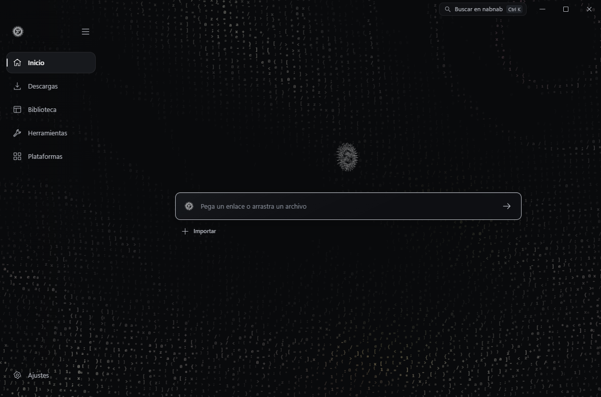
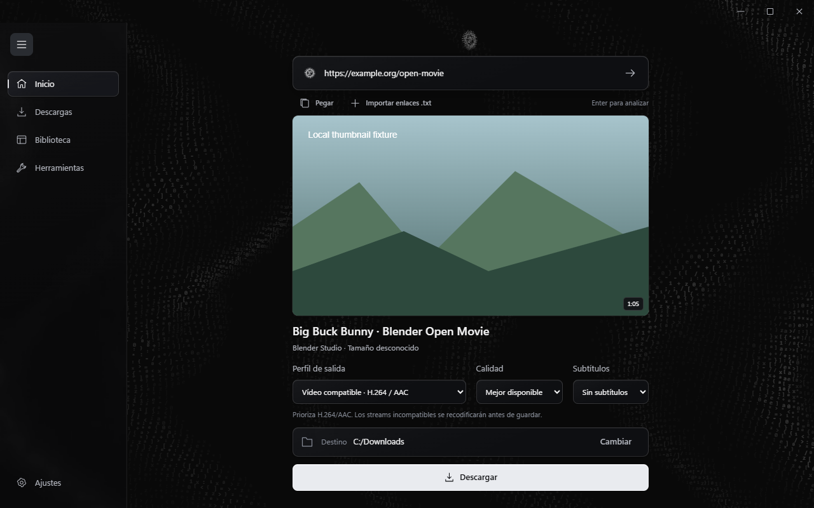

# nabnab

Aplicación local para Windows para descargar, organizar y transformar multimedia. Tauri 2, Rust y TypeScript. Conserva el emblema y el campo de caracteres de YTNabber.

[Descargar nabnab 0.2.0 para Windows x64](https://github.com/Hakaelll/nabnab/releases/tag/v0.2.0). La actualización conserva la carpeta y los datos de la instalación anterior de ytnabber. WebView2 es necesario; el instalador no tiene firma digital.

La ampliación de [productividad local](docs/PRODUCTIVITY.md) añade preparación de lotes, ajustes y reglas, programación, fuentes de YouTube, colecciones inteligentes, subtítulos con búsqueda temporal y una paleta Ctrl+K. La guía incluye capturas y el alcance de las comprobaciones.

La [ampliación de fuentes y herramientas](docs/EXPANSION.md) añade selección de galerías y adjuntos, RSS, archivos avanzados y BitTorrent, Telegram opcional, cursos y herramientas locales de documentos, imágenes, vídeo, audio y transcripción. La guía distingue capacidades implementadas, componentes necesarios y recorridos pendientes con cuentas autorizadas.

La ampliación de [archivos online y herramientas locales](docs/ONLINE-LOCAL.md) incorpora fuentes públicas, conectores de almacenamiento, archivo web, OCR y edición PDF. Incluye organización de archivos, herramientas de imágenes, captura con repetición, voz local y automatización por CLI y MCP. La guía enlaza los requisitos OAuth, las capturas y las pruebas de cada recorrido.

## Interfaz

El acabado glass integra la navegación con el campo de caracteres original. Incluye preferencias para reducir movimiento y transparencias. Estas capturas muestran la interfaz con datos de prueba; los recorridos nativos y de plataformas se registran por separado.





[Sidebar contraída](docs/nabnab-sidebar.png) · [Biblioteca](docs/nabnab-library.png) · [Referencia anterior](docs/nabnab-before.png)

## Uso

1. Pega uno o varios enlaces en Inicio, o importa una lista `.txt`. El análisis no inicia descargas.
2. Elige elementos y perfil, y pulsa Descargar o Añadir a la cola.
3. Revisa actividad y errores en Descargas. Los resultados verificados aparecen en Biblioteca.
4. Importa tus archivos o carpetas sin copiarlos. Selecciona un archivo para reproducirlo, abrirlo con Windows, localizarlo u organizar sus colecciones y etiquetas.
5. En Herramientas puedes convertir, extraer audio, recortar y comprimir. Las operaciones usan la misma cola y conservan los originales.

MP4 compatible comprueba H.264/AAC y convierte las pistas incompatibles cuando hace falta. Calidad original conserva los códecs. Audio original conserva su formato real. Subir el bitrate o convertir audio con pérdida no mejora el original.

Al reiniciar, los trabajos interrumpidos quedan pausados para revisión. Reintentar es una acción explícita. Los archivos existentes no se sobrescriben. Quitar de Biblioteca modifica el índice, no borra el archivo.

Los formatos reproducibles dentro de la app dependen de WebView2. Para otros formatos se ofrece abrir con el reproductor de Windows. Las herramientas y la biblioteca funcionan sin conexión cuando los motores están instalados.

La guía de reproducción recoge los controles de vídeo, las escenas musicales y los formatos probados en Windows. [Reproducción local](docs/playback.md)

## Ejecutar y empaquetar

Requiere Node.js 24, Rust/MSVC, herramientas C++ de Windows y WebView2. La preparación de FFmpeg utiliza vcpkg; esas herramientas de desarrollo no forman parte de la aplicación instalada.

```powershell
npm ci
npm run engines:prepare
npm run desktop:dev
```

```powershell
npm run check
npm test
npm run test:native
npm run desktop:build
```

El instalador se genera en `src-tauri/target/release/bundle/nsis/`. Los motores fijados se incluyen en el paquete. La app puede abrirse si faltan componentes y muestra su estado en Ajustes > Motores. Su instalación o reparación requiere consentimiento.

`npm run dev` muestra la interfaz en un navegador. Las operaciones nativas necesitan la aplicación de escritorio. Las pruebas de interfaz con IPC simulado no certifican motores ni plataformas.

## Navegador y sesiones opcionales

La [extensión Chrome/Edge](docs/BROWSER.md) envía una pestaña o un enlace a la cola. Requiere emparejamiento explícito y permite revocarlo. No lee cookies ni intercepta la navegación.

Las sesiones se importan por sitio desde un archivo Netscape elegido por el usuario. Windows DPAPI las protege en disco. No se incluyen en historial ni diagnósticos. No se implementa elusión de DRM o controles de acceso.

## Verificación y límites

- [Pruebas y límites observados](docs/NABNAB-VERIFICATION.md).
- [Matriz de plataformas](docs/PLATFORMS.md). Que yt-dlp tenga un extractor no certifica cada sitio o contenido.
- [Arquitectura](docs/IMPLEMENTATION.md), [migración](docs/MIGRATION.md) y [herramientas](docs/TOOLS.md).
- [HTTP directo](docs/DIRECT.md) y [subtítulos](docs/SUBTITLES.md).
- [Archivos personales](docs/PERSONAL-ARCHIVES.md) para importar y consultar exportaciones locales por cuenta y categoría.
- [Stickers](docs/STICKERS.md) para exportar imágenes y clips con los perfiles de Telegram y WhatsApp.
- [Ampliación de imágenes](docs/IMAGE-UPSCALE.md) con Real-ESRGAN local y comparación del mismo recorte.
- [Eliminar fondo](docs/REMOVE-BACKGROUND.md) con segmentación local, ajuste de máscara y exportación transparente.
- [Separar pistas](docs/STEMS.md) con escucha sincronizada y exportación local de voz e instrumental.
- [Traducir subtítulos y crear doblaje](docs/TRANSLATION.md) con modelos locales, revisión por segmento, exportación bilingüe y voz sincronizada.
- [Red, motores y privacidad](docs/NETWORK.md), [diseño](docs/design-reference.md) y [plan de trabajo](docs/PLAN.md).
- [Licencias y avisos](THIRD_PARTY_NOTICES.md).

No hay telemetría, fuentes remotas, servicios de extracción intermediarios ni IA en la nube. No hay un servicio nuevo de actualización de nabnab; la actualización de yt-dlp es una operación independiente.

El identificador técnico `com.ytnabber.desktop`, algunas claves de instalación y datos históricos conservan el nombre anterior para mantener compatibilidad. No se renombran los medios existentes. La referencia de arquitectura fue [Omniget en b4c733f](https://github.com/OpenSelena/omniget/tree/b4c733f5a8a699634845e445fc8f162acde547c9), sin copiar su código GPL.
