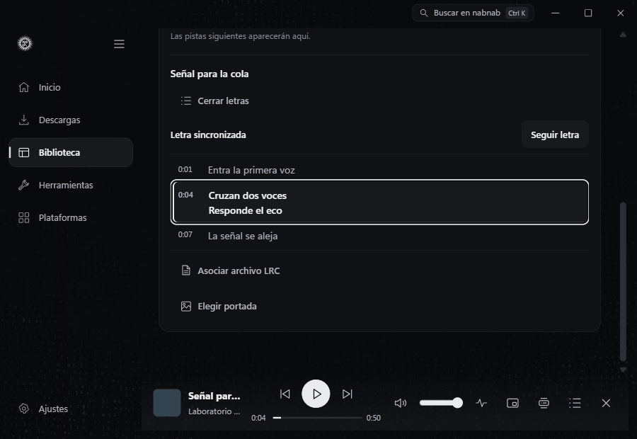
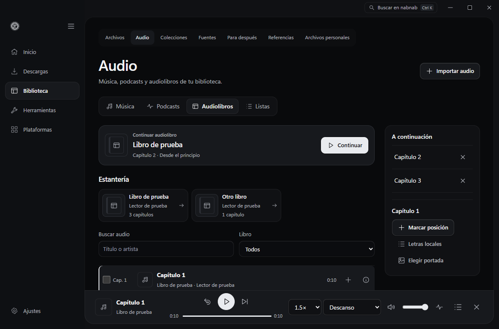
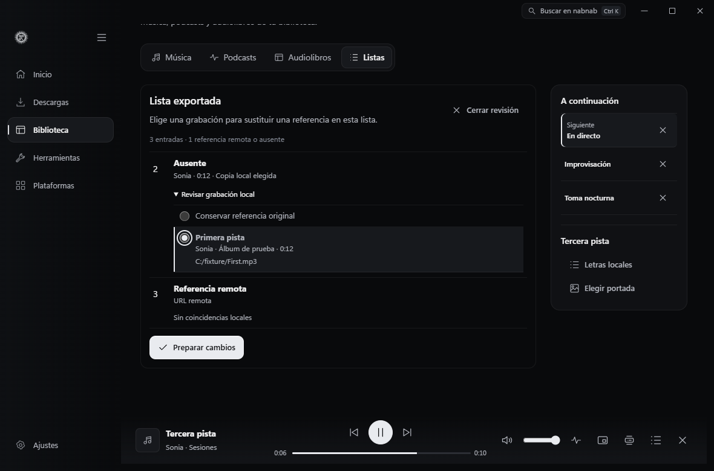
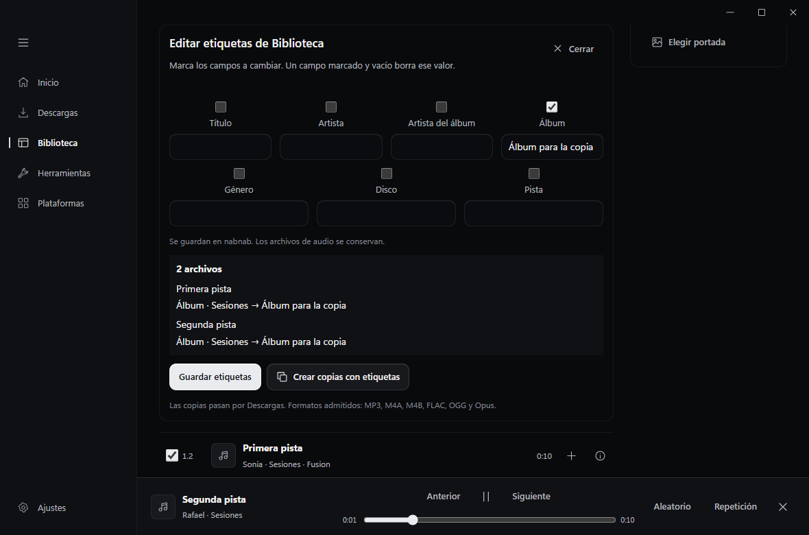
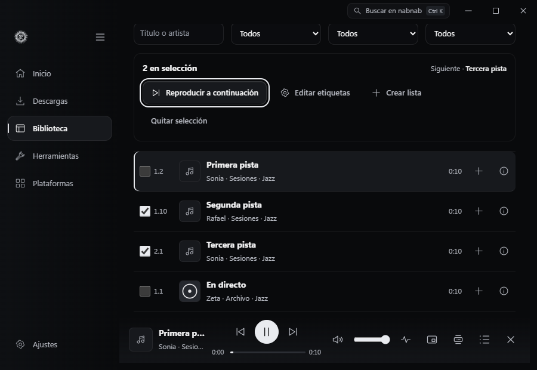
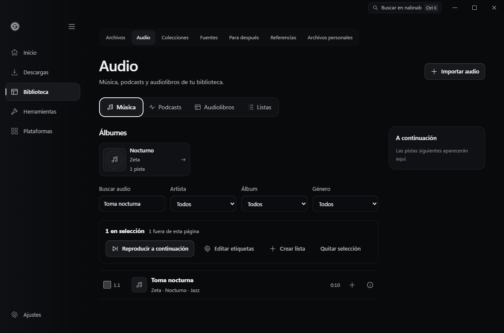

# Biblioteca de audio

En **Biblioteca → Audio** puedes alternar entre Música, Podcasts, Audiolibros y Listas. En Música, elige una tarjeta de **Álbumes** para ver sus pistas, ordenadas por disco y número. La estantería usa portadas locales o incrustadas cuando están disponibles. También puedes filtrar por artista, álbum o género. Si un archivo antiguo aparece sin etiquetas, selecciónalo y usa **Leer etiquetas pendientes**.

Al abrir un álbum, la cabecera muestra su artista, la duración disponible y cuántas pistas faltan en disco. **Reproducir álbum** empieza por la primera pista disponible. **Álbum a continuación** coloca las demás en la cola sin interrumpir la pista actual. Ambas acciones usan el orden de disco y pista como base y abarcan el álbum aunque hayas filtrado la tabla. El reproductor aplica su preferencia de reproducción aleatoria al iniciar la escucha.

Al cambiar entre Música, Podcasts y Audiolibros, cada vista recuerda su búsqueda, página y selección mientras nabnab está abierto. El resumen indica cuántas pistas marcadas quedan fuera de la página actual. Las acciones de selección se aplican a la vista activa.

El minirreproductor permanece visible al cambiar de sección. La cola **A continuación** es independiente de Descargas. En música, puedes activar el modo aleatorio y alternar entre repetir toda la cola o repetir una pista. Los controles multimedia de Windows muestran el título, el artista y la carátula disponible. Utilizan la misma cola aunque la ventana principal esté minimizada.

En Música o Podcasts, marca una o varias pistas y pulsa **Reproducir a continuación**. Las pistas se colocan en el orden en que las marcaste, incluidas las que ya estaban en cola. La pista actual sigue sonando y el orden se conserva al reiniciar. La próxima pista aparece junto a la selección y en **A continuación**. Con la cola vacía, la primera pista queda preparada en pausa.

En **Ajustes → Sesiones y privacidad → Caché de miniaturas** puedes ver cuánto ocupan las carátulas y otras miniaturas generadas. nabnab retira las más antiguas al superar 512 imágenes o 128 MiB. **Vaciar miniaturas…** pide confirmación. Las imágenes se generan de nuevo al necesitarlas.

La **Estantería** de audiolibros agrupa capítulos de LibriVox y reconoce archivos M4B. **Continuar** recupera el punto guardado del capítulo o abre el siguiente si el anterior llegó al final. La cola de capítulos se limita al libro que estás escuchando. El minirreproductor ofrece velocidad, retroceso de 15 segundos y temporizador por minutos o al final del capítulo. Los marcadores se guardan en Biblioteca. Si hay capítulos incrustados, se puede saltar a ellos.

Abre un M4B desde la **Estantería** para ver sus capítulos antes de reproducirlo. **Reproducir** abre el capítulo desde el inicio y **Retomar** vuelve al punto guardado de ese capítulo. **Continuar audiolibro** indica el nombre del último capítulo y el tiempo transcurrido dentro de él. Los puntos se conservan al cerrar nabnab y al pasar a otro capítulo desde el índice.

Selecciona pistas para crear una lista, añadirlas a una existente o editar sus etiquetas. Puedes cambiar el orden y quitar entradas desde **Listas → Editar lista**. La previsualización de etiquetas muestra los campos que cambiarán. **Guardar etiquetas** actualiza la base de nabnab. **Crear copias con etiquetas** usa la cola para generar archivos nuevos y compara la huella de los flujos de audio antes de incorporarlos a Biblioteca. Se probaron MP3, M4A, M4B, FLAC, OGG y Opus con los motores de producción. Los originales se conservan.

Desde la pista actual, **Elegir portada** permite asociar un JPEG, PNG o WebP local. Quitar la asociación vuelve a mostrar la portada incrustada cuando está disponible.

**Letras locales** lee el LRC que acompaña a la pista. **Asociar archivo LRC** permite elegir otro archivo local. El panel marca la línea actual y se actualiza al cambiar de pista. Pulsa una línea para saltar a su marca de tiempo o desactiva **Seguir letra** para recorrer la lista a tu ritmo. Las líneas con la misma marca aparecen juntas.

En **Listas → Importar lista** puedes abrir M3U, M3U8, PLS o CSV en UTF-8. En CSV, confirma las columnas y la unidad de duración. nabnab reconoce identificadores y rutas de archivos que ya están en Biblioteca. Abre las sugerencias de una entrada para comparar la duración y la ruta completa de las grabaciones. El indicador de versión compara el texto con el nombre del archivo o del álbum. La referencia remota o ausente queda seleccionada al empezar. Puedes elegir una grabación local y preparar la lista conservando su orden.

Cuando incorpores más música, abre la lista guardada y pulsa **Revisar referencias**. Verás las entradas remotas o ausentes en su posición original, con las grabaciones disponibles en Biblioteca. Las nuevas importaciones conservan los datos de identificación, artista, duración y versión cuando el archivo los incluye. Las listas antiguas pueden buscar por título o por el identificador o la ruta que ya tengan guardados. Elige una grabación, pulsa **Preparar cambios** y después **Guardar lista**. Puedes cerrar la revisión para conservar las referencias originales.

La prueba de interfaz reproduce un WAV silencioso en Edge con almacenamiento de escritorio simulado. Comprueba el orden por disco y pista, la estantería con teclado, la continuidad del reproductor, el descanso de audiolibros, las letras y la edición de listas y etiquetas. La prueba nativa usa audio sintético y verifica que, después de reiniciar nabnab, **Continuar** abre el capítulo siguiente de un libro cuyo capítulo anterior terminó. La integración con Windows se comprueba mediante solicitudes del sistema a la sesión multimedia de prueba.

Con `NABNAB_PLAYBACK_LYRICS=1`, `tests/native-playback.browser.mjs` abre dos LRC locales. Comprueba el desplazamiento de tiempo declarado en el archivo, las líneas simultáneas y el cambio de letra al pasar de pista. La revisión visual se hizo a 900 y 1180 px.

Con `NABNAB_PLAYBACK_EMBEDDED_BOOK=1`, `tests/native-playback.browser.mjs` importa un M4B local de tres capítulos, guarda dos puntos de escucha y comprueba ambos tras reiniciar nabnab. También verifica que el resumen cambia al retomar y pausar otro capítulo. La revisión visual se hizo a 900 y 1180 px. [Índice de capítulos en Windows](audio-embedded-chapters.png)

Con `NABNAB_PLAYBACK_ALBUM=1`, la prueba nativa importa MP3 sintéticos de dos discos en orden distinto al del álbum. Comprueba que un archivo ausente queda fuera de la reproducción, que un filtro de la tabla no limita el álbum y que ponerlo a continuación conserva la pista activa y el orden al recargar WebView2. La cabecera se revisó a 900 y 1180 px.

