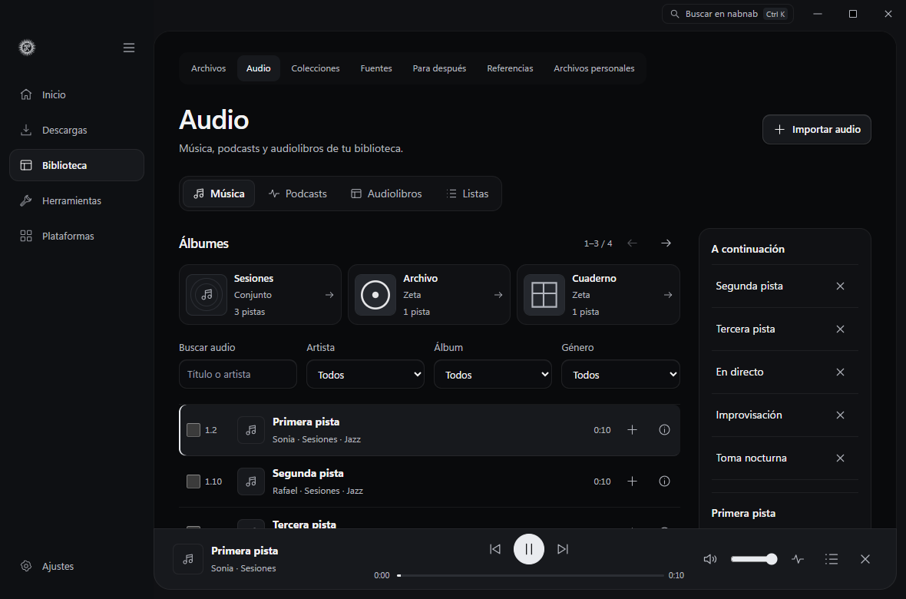
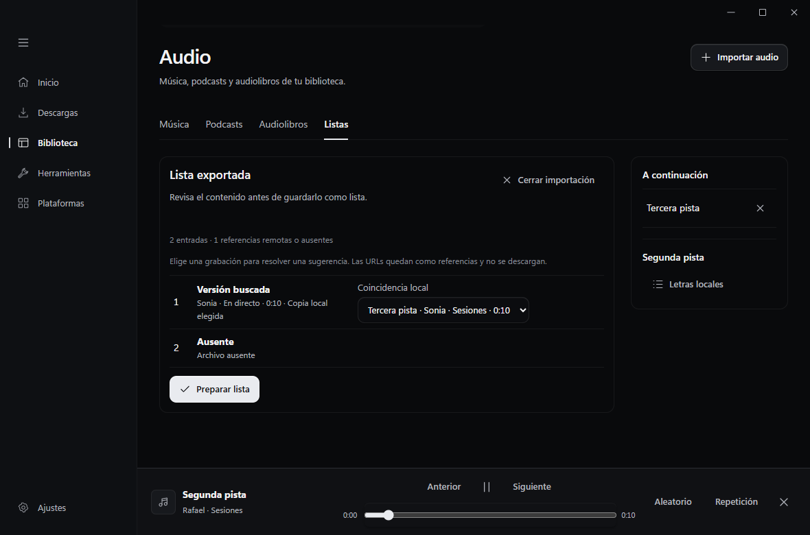

# Biblioteca de audio

En **Biblioteca → Audio** puedes alternar entre Música, Podcasts, Audiolibros y Listas. Música agrupa y ordena las pistas por artista del álbum, álbum, disco y número de pista. Filtra por artista, álbum o género. Si un archivo antiguo aparece sin etiquetas, selecciónalo y usa **Leer etiquetas pendientes**.

El minirreproductor permanece visible al cambiar de sección. La cola **A continuación** es independiente de Descargas. En música, puedes activar el modo aleatorio y alternar entre repetir toda la cola o repetir una pista. Las teclas multimedia usan los controles que expone Media Session en el WebView. Las carátulas incrustadas utilizan la caché de miniaturas de nabnab.

Los audiolibros agrupan capítulos de LibriVox y reconocen archivos M4B. **Continuar** recupera la posición guardada. El minirreproductor ofrece velocidad, retroceso de 15 segundos y temporizador por minutos o al final del capítulo. Los marcadores se guardan en Biblioteca. Si hay capítulos incrustados, se puede saltar a ellos.

Selecciona pistas para crear una lista, añadirlas a una existente o editar sus etiquetas. Puedes cambiar el orden y quitar entradas desde **Listas → Editar lista**. La previsualización de etiquetas muestra los campos que cambiarán. Los cambios se guardan en la base de nabnab y el audio se conserva intacto.

**Letras locales** lee el archivo LRC junto a la pista si está disponible. **Asociar archivo LRC** permite elegir otro archivo local. Cada línea permite saltar a su marca de tiempo.

En **Listas → Importar lista** puedes abrir M3U, M3U8, PLS o CSV en UTF-8. En CSV, confirma las columnas y la unidad de duración. nabnab reconoce identificadores y rutas de archivos que ya están en Biblioteca. Las coincidencias por título, artista, duración o versión son sugerencias. Puedes escoger la grabación o conservar la referencia remota o ausente. La lista conserva el orden y las URLs importadas permanecen como referencias.

La prueba de interfaz reproduce un WAV silencioso en Edge con almacenamiento de escritorio simulado. Comprueba el orden por disco y pista, la continuidad del reproductor, el descanso de audiolibros, las letras y la edición de listas y etiquetas. Las teclas físicas del sistema requieren una prueba en el WebView de escritorio.

