# Cursos y estudio local

La vista Cursos permite importar una carpeta y organiza sus archivos por subcarpetas, con orden natural para nombres numerados. Los archivos se incorporan a la biblioteca común. Cada lección conserva su estado aprendido, sus notas y la posición del reproductor existente. Una nota temporal también crea un marcador en la biblioteca. Guardado y aprendido son estados diferentes. Volver a importar o actualizar materiales conserva las notas y las lecciones anteriores.

Busca por unidad, título de lección o nombre del adjunto. La búsqueda admite texto con o sin tildes y agrupa las coincidencias por unidad, incluidas las que estaban cerradas. Pulsa **Intro** sobre un resultado para abrirlo. Al borrar el texto se recupera la expansión anterior y queda abierta la unidad de la lección elegida.

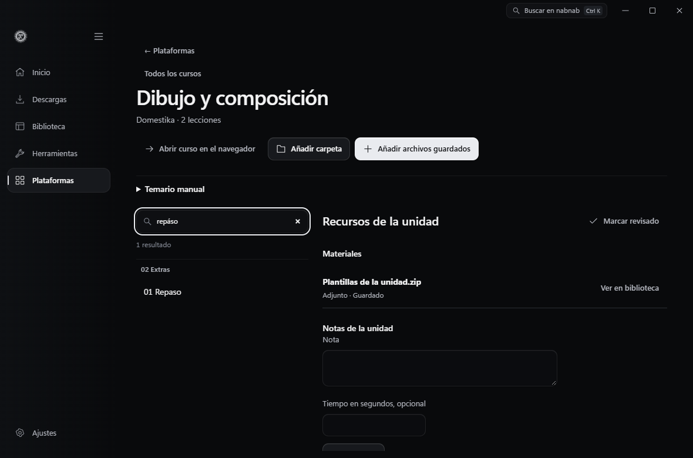

**Reproducir lección** abre el primer vídeo o audio disponible en el reproductor compartido. El vídeo vuelve a la lección en pausa. El audio continúa en la barra compacta mientras consultas materiales y notas, y recupera su posición aunque sea una lección corta. **Usar tiempo actual** toma la posición del archivo de la lección cuando está en el reproductor. Pulsa el tiempo de una nota para volver a ese punto.

Si la lección pendiente con la posición guardada más reciente es distinta de la que tienes abierta, **Retomar lección** muestra su nombre y el punto de escucha o visionado. Al pulsar el botón se abre esa lección y se reproduce desde ese punto. Cuando ninguna posición tiene fecha, se usa el orden del temario.

La prueba `NABNAB_PLAYBACK_COURSE_RESUME=1` en Windows comprueba que el curso reanuda un vídeo local tras reiniciar y propone el audio pendiente al marcar el vídeo como aprendido.

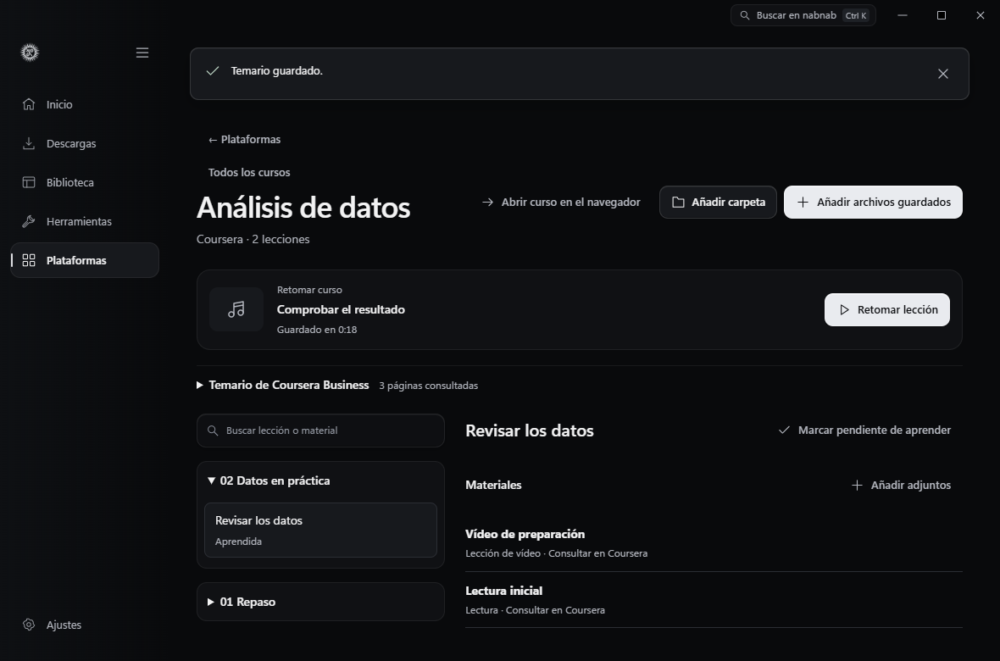

Para Udemy, importa una sesión desde Ajustes → Sesiones y abre el enlace de un curso al que tengas acceso. El explorador hace únicamente peticiones GET al curso, currículo y detalles de lecciones autorizados. No ejecuta el extractor de curso de yt-dlp, que puede intentar inscribir una cuenta. Solo ofrece las URL de `download_urls` que entregue Udemy; excluye DRM y materiales marcados como no descargables. El límite inicial es 100 lecciones, editable hasta 1000. Un currículo parcial se identifica en el título.

Hotmart y Kiwify tienen adaptadores separados. Elige la plataforma, conecta un token de alumno autorizado, indica el enlace y el identificador numérico del curso o producto. Hotmart necesita además el slug del club. Se consulta el árbol de módulos y lecciones de la cuenta. Los adjuntos se resuelven mediante las rutas de descarga de cada proveedor. Un enlace de reproducción o un código de vídeo no acredita descarga; el vídeo solo se ofrece si la respuesta declara que es descargable y proporciona su URL de descarga. No se descifran recursos ni se usan los endpoints de compradores/vendedores para simular acceso de alumno.

Cada plataforma conserva una conexión de alumno predeterminada. Los tokens de Hotmart y Kiwify se protegen con el almacén de secretos local existente; las cookies de Udemy usan el gestor de sesiones. La conexión se elimina por separado de los archivos. Las peticiones fijan DNS público, restringen HTTPS a una lista concreta de orígenes del proveedor y rechazan redirecciones para impedir reenviar autenticación. Las URL firmadas de materiales se guardan como referencias protegidas y se resuelven dentro del backend al preparar la cola.

Seleccionar una sección añade sus materiales disponibles a la selección. Añadir a la cola crea trabajos reales en Descargas y deposita los resultados en Biblioteca y en la colección del curso. Se omiten los materiales locales o con un trabajo activo o completado existente. Se puede volver a seleccionar lo que falló. Las carpetas de destino usan identificadores estables de curso y sección; actualizar parte del currículo no renombra archivos guardados.

Los adjuntos PDF/EPUB dependen de la lectura y clasificación documental de la biblioteca. El módulo de cursos no ejecuta adjuntos ni contenido HTML de lecciones. No muestra compras ni catálogos externos, y conectar una sesión no descarga todo el curso.

## Materiales de Rocketseat, Coursera, Domestika y Skillshare

Abre **Plataformas → Cursos**, elige el proveedor y pega el enlace del curso. También puedes pegar el enlace en Inicio. Abre el curso en el navegador y elige allí el perfil o la sesión autorizada. Guarda el material desde los controles que la plataforma haya habilitado. En nabnab, indica el nombre del curso y pulsa **Elegir archivos guardados** o **Elegir carpeta del curso**. También puedes arrastrar los archivos o una carpeta desde el Explorador de Windows sobre la vista del curso. Puedes revisar hasta 200 archivos compatibles por operación.

**Revisar materiales** agrupa los archivos por carpeta y muestra el tipo, el tamaño y el total seleccionado. Marca archivos individuales o una unidad completa y pulsa **Añadir al curso**. La biblioteca indexa los archivos elegidos en su ubicación actual. Si eliges una carpeta, nabnab incluye las subcarpetas y se detiene si encuentra un enlace simbólico o una unión de directorios. Si cambia el tamaño o la fecha de un archivo seleccionado durante la revisión, vuelve a elegirlo.

Para conservar el orden del curso, guarda cada unidad en una carpeta numerada y numera los nombres de las lecciones. Los archivos con el mismo nombre base en la misma carpeta aparecen juntos, por ejemplo, un vídeo y su subtítulo. Los ZIP, RAR, 7z y archivos de diseño admitidos quedan como adjuntos para consultar en su carpeta. **Añadir carpeta** y **Añadir archivos guardados** amplían el curso existente y conservan las notas, el estado aprendido y la posición asociada a los archivos ya indexados.

Si un documento, subtítulo, imagen o archivo comprimido pertenece a una lección ya importada, ábrela y usa **Materiales → Añadir adjuntos**. La revisión muestra la lección de destino y permite marcar archivos aunque tengan otro nombre o estén en otra carpeta. Al confirmar con **Añadir a la lección**, se vinculan a la lección existente. Repetir la importación conserva la asociación. Los vídeos y audios se incorporan desde **Añadir archivos guardados** o **Añadir carpeta**.

Si cambias de carpeta un archivo que sigue en Biblioteca, abre la lección o los recursos de la unidad y elige **Localizar archivo** junto a **Archivo ausente**. Selecciona el mismo archivo en su nueva ubicación. El vínculo, las notas y el punto de reproducción se conservan. Si recuperas un adjunto descargado, nabnab lo sigue reconociendo en el curso al volver a abrirlo.

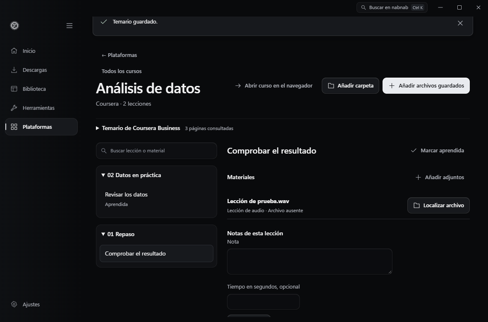

| Plataforma | Vía disponible |
| --- | --- |
| Rocketseat | Pega un enlace de [formación](https://app.rocketseat.com.br/journey/discover/contents) o de [aula](https://app.rocketseat.com.br/classroom/git-e-github). Cada uno tiene su propio índice en nabnab. Abre el enlace en el navegador con tu sesión e importa únicamente archivos que se te haya autorizado a guardar. Sus [condiciones de uso](https://www.rocketseat.com.br/termos-de-uso) prohíben descargar las videoclases. |
| Coursera | Usa los controles habilitados en cada lección. La [API documentada](https://dev.coursera.com/get-started) requiere credenciales de una organización Business, Campus o Government. Las [condiciones de uso](https://www.coursera.org/about/terms) requieren autorización previa para extraer contenido automáticamente. |
| Domestika | Guarda los [recursos adicionales](https://support.domestika.org/hc/en-us/articles/360003129937-I-can-t-download-the-additional-resources) desde la web. Los [vídeos offline](https://support.domestika.org/hc/en-us/articles/360003651177-Can-I-download-the-courses) se reproducen en la app de Domestika. |
| Skillshare | Copia los enlaces a archivos de [Proyectos y recursos → Descargar recursos](https://help.skillshare.com/hc/en-us/articles/217440617-How-do-I-access-class-materials-or-additional-resources), o importa los archivos guardados. Los [vídeos offline](https://help.skillshare.com/hc/en-us/articles/205221147-How-do-I-download-videos-for-offline-viewing) se reproducen en la app de Skillshare. |

En Rocketseat, Coursera y Domestika, la sesión de alumno y la descarga se gestionan en el sitio oficial. El índice local asocia los archivos elegidos con su curso. En Skillshare, el flujo de enlaces directos que se describe abajo permite enviar adjuntos públicos a Descargas después de revisarlos. Los usuarios autorizados de Coursera Business pueden consultar el temario con su token de organización.

### Temario manual

En Rocketseat, Domestika y Skillshare puedes organizar el curso antes de añadir archivos. Indica el enlace y el nombre del curso y abre **Temario manual**. Escribe `# ` antes de cada título de unidad y pon una lección por línea. Usa títulos distintos dentro de cada unidad. **Revisar temario** muestra el orden y el total antes de guardar. La sesión y la consulta del curso se hacen en el sitio oficial.

Puedes añadir adjuntos a cada lección desde la vista de estudio. En Domestika también puedes añadir recursos a la unidad. En Skillshare puedes revisar enlaces directos y asociarlos a una lección del temario. Guardar el temario no crea trabajos en Descargas.

Al editar el temario, conserva el título de cada unidad y lección para mantener su identidad. Cambiar el orden conserva los adjuntos, las notas y el progreso. Los elementos que omitas se conservan al final. Cambiar un título crea una entrada distinta, conservando la anterior.

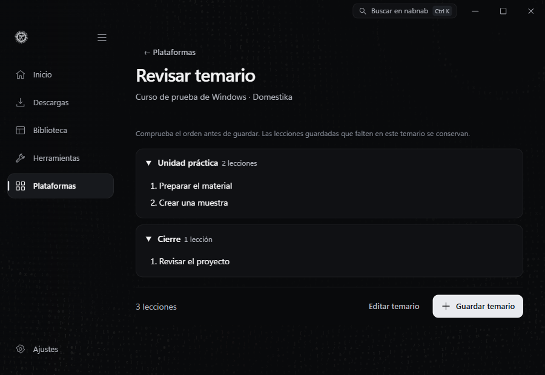

La prueba nativa de Windows guarda temarios sintéticos de los tres proveedores y comprueba que la revisión no escribe en el índice. Verifica el orden, el foco a 900 y 1180 px, y que al reordenar se conservan las notas, el progreso y un adjunto de Skillshare. No usa sesiones ni descarga los materiales de prueba.

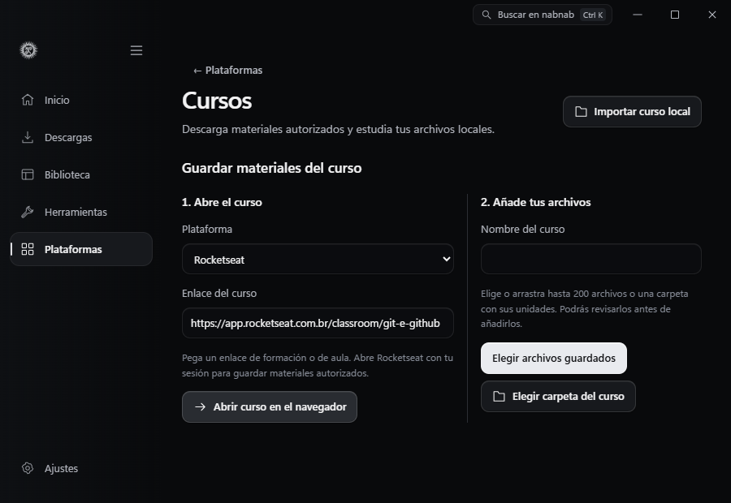

La prueba de Rocketseat en Edge pega un enlace público de aula en Inicio y comprueba el formulario a 900 y 1180 px. La prueba de Rust importa dos veces el mismo archivo sintético, conserva una sola copia en el índice y distingue el aula de una formación con el mismo nombre en la URL.

### Recursos por unidad de Domestika

Guarda los archivos habilitados en **Recursos adicionales** desde tu sesión de Domestika. Abre la unidad correspondiente en el curso de nabnab y pulsa **Añadir recursos a la unidad**. Revisa el nombre de la unidad, marca los archivos y confirma con **Añadir a la unidad**. Los archivos quedan en su ubicación original y aparecen en **Recursos de la unidad**, junto a las lecciones. Puedes buscar por el nombre del archivo y volver a la lección con sus notas y su progreso. [Recursos adicionales de Domestika](https://support.domestika.org/hc/en-us/articles/360003408898-I-can-t-download-the-additional-resources-from-the-app) · [Condiciones de uso](https://www.domestika.org/es/terms)

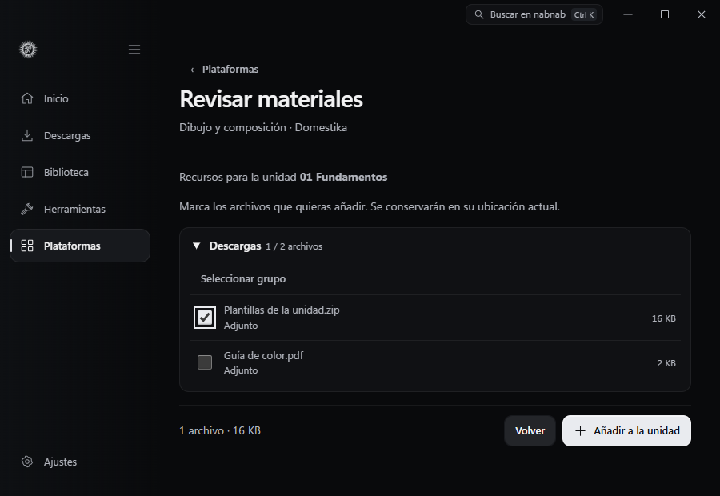

Las pruebas usan materiales sintéticos. Rust verifica la asociación tras reabrir el índice, la importación repetida, el rechazo de unidades ajenas al destino y la conservación de notas y progreso. Edge comprueba la selección, la búsqueda y el foco a 900 y 1180 px con IPC simulado.

### Revisión de archivos guardados

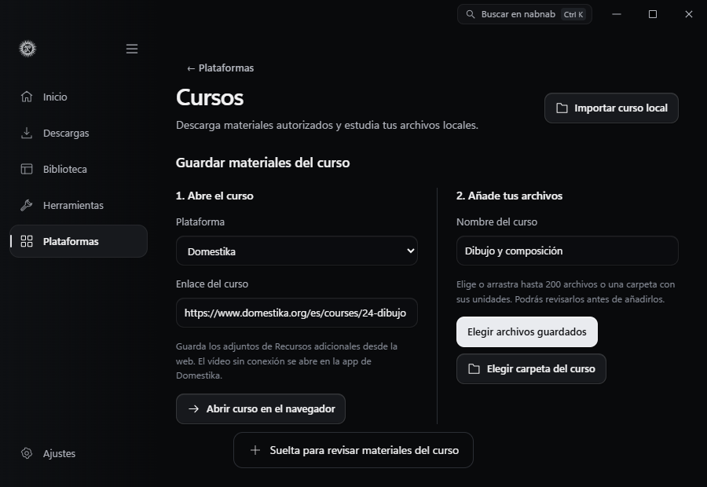

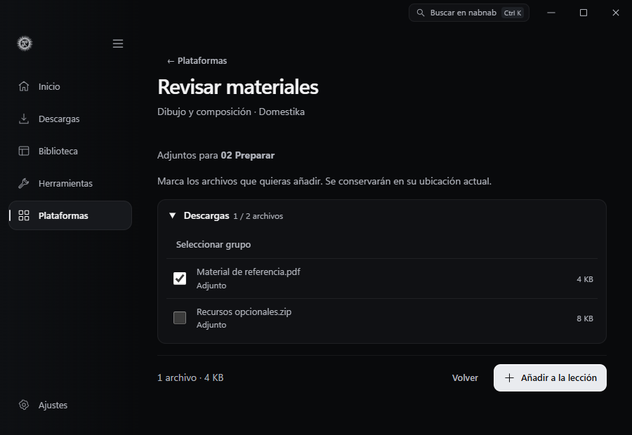

`tests/native-course-materials.browser.mjs` abre un perfil aislado de Windows y comprueba que el comando de revisión rechaza un archivo local cuando no hay un arrastre nativo que lo autorice. La biblioteca y los cursos quedan vacíos y el perfil temporal se elimina al terminar. Ejecuta `node tests/native-course-materials.browser.mjs` con Vite en el puerto 1420 y el ejecutable de depuración actualizado. El recorrido de arrastre entre ventanas sigue pendiente de comprobar con el Explorador.

La prueba de Edge simula cancelar el selector y recuperar el audio de una lección a 900 y 1180 px. Comprueba el foco, la nota y la posición guardada. Las pruebas Rust mueven archivos reales de prueba, reabren el índice y comprueban que el adjunto recuperado no se vuelve a añadir a Descargas.

### Temario de Coursera Business

1. En **Plataformas → Cursos**, selecciona **Coursera**, pega el enlace del curso e indica su nombre.
2. Abre **Temario de Coursera Business**. Introduce los identificadores de organización, programa y curso. Usa un token de acceso emitido para una aplicación autorizada de Business, Campus o Government. [Cómo obtener un token en Coursera](https://dev.coursera.com/get-started)
3. Pulsa **Consultar temario**. nabnab guarda módulos, lecciones y materiales en el orden de la API. Si la respuesta incluye un enlace de continuación con un desplazamiento numérico hacia delante, la consulta sigue ese enlace dentro del mismo curso. El token se envía a `api.coursera.com` durante la consulta y se borra del formulario. [API de materiales del curso](https://dev.coursera.com/docs/coursera-for-business-api-product/1/routes/api%2Fbusinesses.v1%2F%7BorgId%7D%2Fprograms%2F%7BprogramId%7D%2FcourseMaterials%2F%7BcourseId%7D/get)
4. Usa **Abrir curso en el navegador** para consultar las lecturas, vídeos y actividades con tu sesión de alumno. Guarda los archivos que el sitio permita descargar y vincúlalos a su lección con **Añadir adjuntos**. Actualizar el temario conserva las notas, el estado aprendido y los adjuntos locales de las lecciones que ya están guardadas.

Cada consulta admite hasta ocho páginas y 60 segundos. Si Coursera anuncia más páginas y se alcanza el límite o no hay un enlace de continuación válido, el panel muestra **Temario parcial** junto al número de páginas consultadas. Una página que repite los resultados también deja el temario como parcial. Un error de red o de autorización deja el temario guardado en su estado anterior. Los enlaces de acceso a lecciones pueden inscribir al alumno. nabnab guarda el tipo y el nombre de cada material y abre el enlace general del curso.

Las pruebas de Rust usan respuestas sintéticas y cubren la unión de páginas con elementos repetidos, el orden y la persistencia. La prueba de Edge revisa el estado a 900 y 1180 px, el regreso desde la lista de cursos y el reintento tras un token caducado simulado. La consulta con un token real de organización queda pendiente.

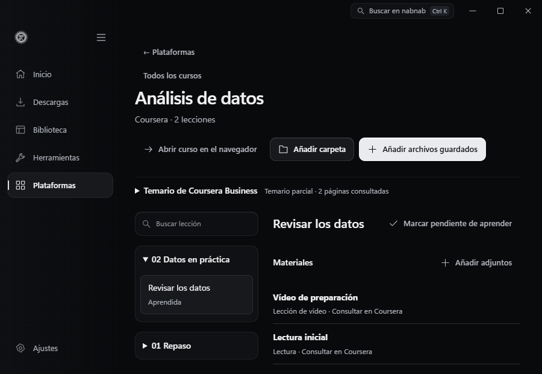

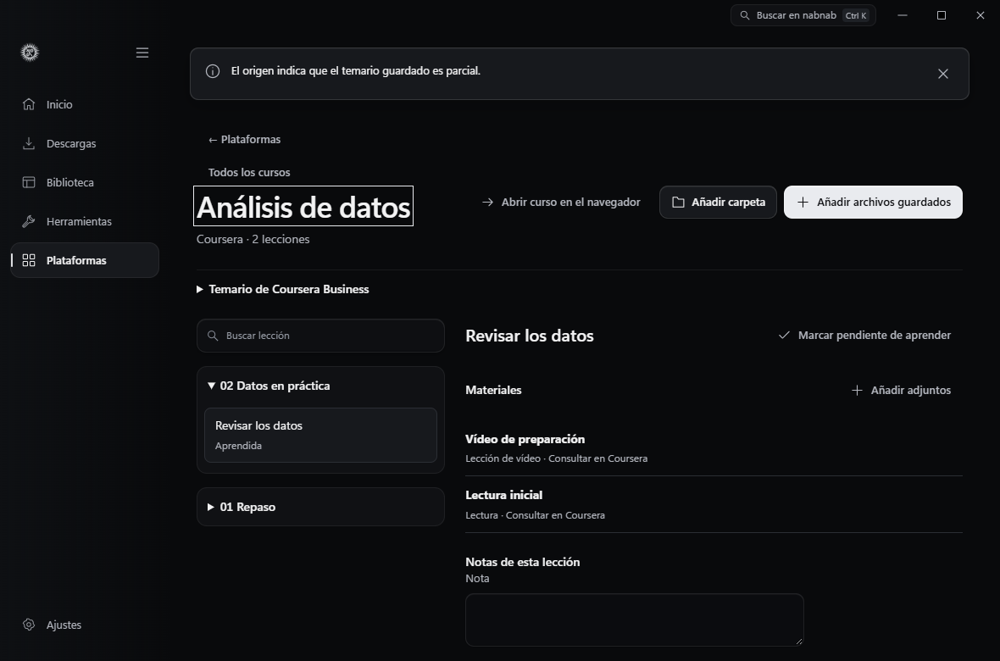

### Adjuntos de Skillshare

Abre el curso en Skillshare con tu sesión. En **Proyectos y recursos → Descargar recursos**, copia el enlace directo de cada archivo que el docente haya habilitado para descargar. En nabnab, abre **Descargar adjuntos de Skillshare**, pega un enlace por línea y pulsa **Revisar enlaces**. Puedes revisar hasta 30 enlaces por operación. La lista distingue los enlaces compatibles, duplicados e incompatibles. Marca los que quieras guardar y confirma con **Añadir al curso** o **Añadir a la lección**. Ya en el curso, selecciona los archivos que quieras descargar y pulsa **Añadir a la cola**. Los trabajos guardan los archivos en la carpeta de Descargas configurada y los asocian al curso. [Descargas autorizadas en las condiciones de Skillshare](https://learn.skillshare.com/en/terms)

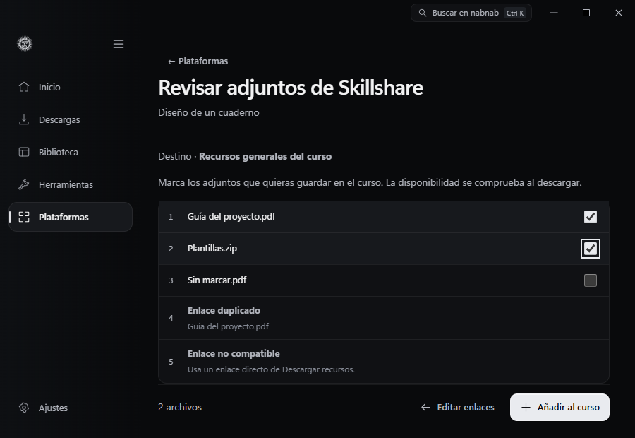

Si ya importaste las lecciones del curso, usa **Guardar en** para elegir una de ellas. Tras confirmar la selección, los adjuntos aparecen en **Materiales** junto al contenido y las notas de esa lección. **Recursos generales del curso** guarda los enlaces en la sección común. Si un adjunto ya está asociado a otro destino, nabnab indica dónde se encuentra.

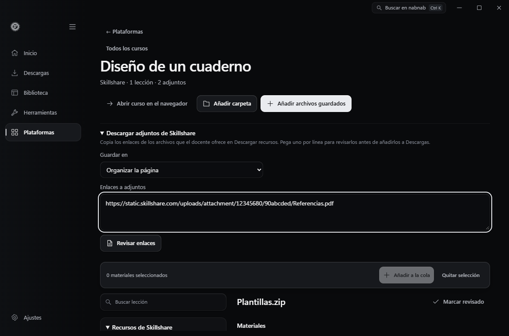

La cola acepta documentos, imágenes y archivos comprimidos desde el CDN oficial `static.skillshare.com`, con un límite de 104 MiB por archivo. Los adjuntos conservan su nombre y se ordenan como se pegaron. Volver a revisar el mismo adjunto conserva su estado y sus notas. Para un recurso que solo se pueda guardar en el navegador, usa **Elegir archivos guardados**. El flujo de enlaces revisa los adjuntos elegidos y deja el currículo y las videolecciones en Skillshare.

Las pruebas usan enlaces y archivos sintéticos. Rust comprueba la selección persistente y la conservación de notas, y la interfaz en Edge comprueba la revisión y el envío selectivo a la cola a 900 y 1180 px. Queda por verificar la transferencia contra el CDN de Skillshare desde una clase autorizada.

## Referencias y límites

Se consultaron las interfaces de [cursos de Omniget](https://github.com/OpenSelena/omniget/tree/main/src-tauri/plugins/courses/src/platforms), bajo [GPL-3.0](https://github.com/OpenSelena/omniget/blob/main/LICENSE), y el [extractor oficial de Udemy de yt-dlp](https://github.com/yt-dlp/yt-dlp/blob/master/yt_dlp/extractor/udemy.py). No se copiaron código, recursos ni credenciales. Las rutas de alumno observadas en Hotmart y Kiwify requieren comprobación con cuentas autorizadas y pueden cambiar. La [API pública documentada de Kiwify](https://docs.kiwify.com.br/api-reference/general) es una API de negocio y no sustituye la sesión de alumno.

No hubo cuentas autorizadas de prueba ni descargas personales. Los fixtures verifican el árbol real de respuesta, el orden y los identificadores, la selección de descargas explícitas frente a streams y DRM, la conservación de notas y las carpetas locales. Queda pendiente comprobar en vivo la sesión, paginación y descarga de materiales de cada proveedor. Los errores de acceso o cambios de API se muestran y no se convierten en cursos ficticios.

La prueba nativa `tests/native-playback.browser.mjs` usa archivos sintéticos. Comprueba que una lección sustituye a la música en la misma sesión, que su nota temporal se guarda en el vídeo aunque la lista empiece con un documento y que una lección corta de audio conserva la posición al reiniciar la aplicación.
