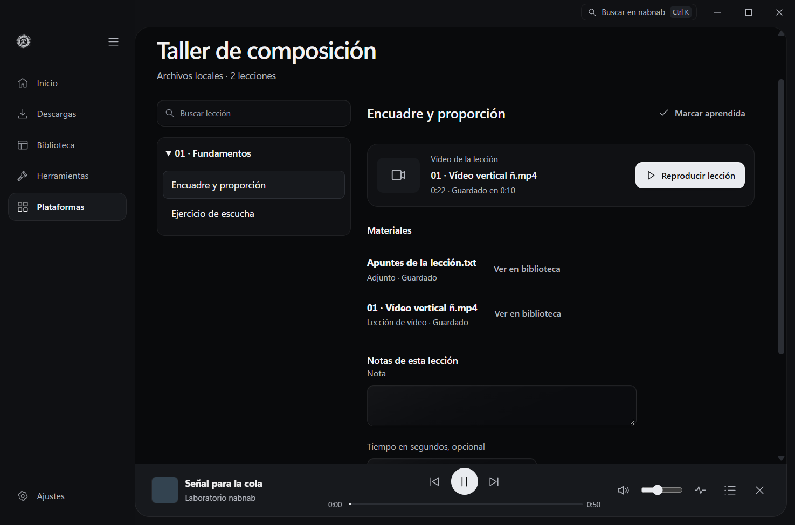
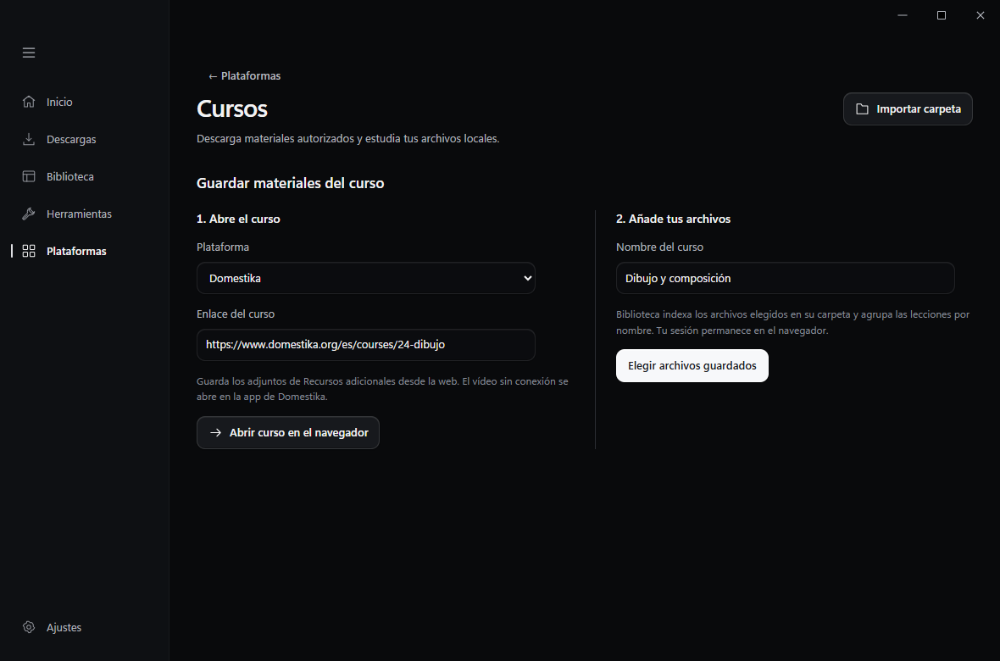
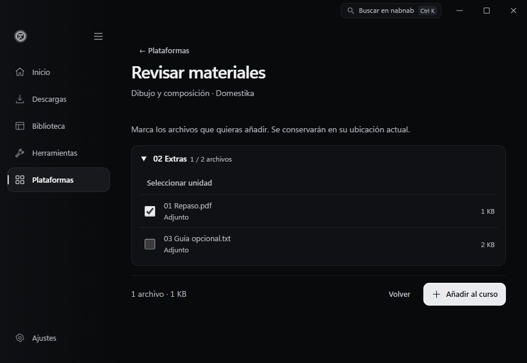
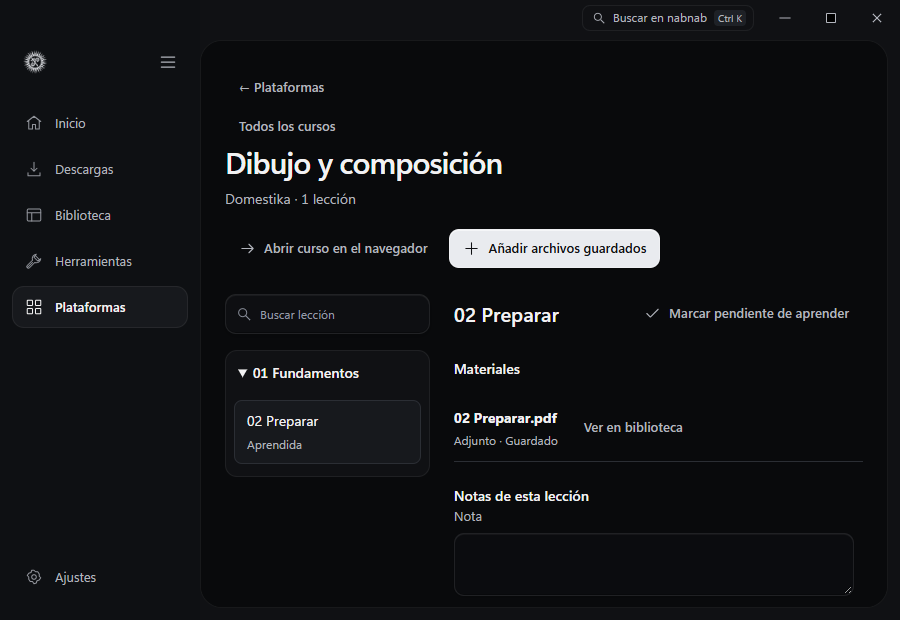
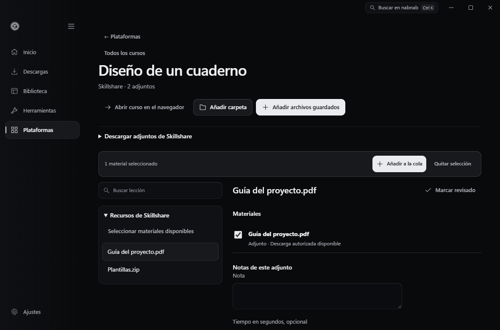

# Cursos y estudio local

La vista Cursos permite importar una carpeta y organiza sus archivos por subcarpetas, con orden natural para nombres numerados. Los archivos se incorporan a la biblioteca común. Cada lección conserva su estado aprendido, sus notas y la posición del reproductor existente. Una nota temporal también crea un marcador en la biblioteca. Guardado y aprendido son estados diferentes. Volver a importar o actualizar materiales conserva las notas y las lecciones anteriores.

**Reproducir lección** abre el primer vídeo o audio disponible en el reproductor compartido. El vídeo vuelve a la lección en pausa. El audio continúa en la barra compacta mientras consultas materiales y notas, y recupera su posición aunque sea una lección corta. **Usar tiempo actual** toma la posición del archivo de la lección cuando está en el reproductor. Pulsa el tiempo de una nota para volver a ese punto.

Para Udemy, importa una sesión desde Ajustes → Sesiones y abre el enlace de un curso al que tengas acceso. El explorador hace únicamente peticiones GET al curso, currículo y detalles de lecciones autorizados. No ejecuta el extractor de curso de yt-dlp, que puede intentar inscribir una cuenta. Solo ofrece las URL de `download_urls` que entregue Udemy; excluye DRM y materiales marcados como no descargables. El límite inicial es 100 lecciones, editable hasta 1000. Un currículo parcial se identifica en el título.

Hotmart y Kiwify tienen adaptadores separados. Elige la plataforma, conecta un token de alumno autorizado, indica el enlace y el identificador numérico del curso o producto. Hotmart necesita además el slug del club. Se consulta el árbol de módulos y lecciones de la cuenta. Los adjuntos se resuelven mediante las rutas de descarga de cada proveedor. Un enlace de reproducción o un código de vídeo no acredita descarga; el vídeo solo se ofrece si la respuesta declara que es descargable y proporciona su URL de descarga. No se descifran recursos ni se usan los endpoints de compradores/vendedores para simular acceso de alumno.

Cada plataforma conserva una conexión de alumno predeterminada. Los tokens de Hotmart y Kiwify se protegen con el almacén de secretos local existente; las cookies de Udemy usan el gestor de sesiones. La conexión se elimina por separado de los archivos. Las peticiones fijan DNS público, restringen HTTPS a una lista concreta de orígenes del proveedor y rechazan redirecciones para impedir reenviar autenticación. Las URL firmadas de materiales se guardan como referencias protegidas y se resuelven dentro del backend al preparar la cola.

Seleccionar una sección añade sus materiales disponibles a la selección. Añadir a la cola crea trabajos reales en Descargas y deposita los resultados en Biblioteca y en la colección del curso. Se omiten los materiales locales o con un trabajo activo o completado existente. Se puede volver a seleccionar lo que falló. Las carpetas de destino usan identificadores estables de curso y sección; actualizar parte del currículo no renombra archivos guardados.

Los adjuntos PDF/EPUB dependen de la lectura y clasificación documental de la biblioteca. El módulo de cursos no ejecuta adjuntos ni contenido HTML de lecciones. No muestra compras ni catálogos externos, y conectar una sesión no descarga todo el curso.

## Materiales de Rocketseat, Coursera, Domestika y Skillshare

Abre **Plataformas → Cursos**, elige el proveedor y pega el enlace del curso. También puedes pegar el enlace en Inicio. Abre el curso en el navegador y elige allí el perfil o la sesión autorizada. Guarda el material desde los controles que la plataforma haya habilitado. En nabnab, indica el nombre del curso y pulsa **Elegir archivos guardados** o **Elegir carpeta del curso**. Puedes importar hasta 200 archivos compatibles por operación.

**Revisar materiales** agrupa los archivos por carpeta y muestra el tipo, el tamaño y el total seleccionado. Marca archivos individuales o una unidad completa y pulsa **Añadir al curso**. La biblioteca indexa los archivos elegidos en su ubicación actual. Si eliges una carpeta, nabnab incluye las subcarpetas y se detiene si encuentra un enlace simbólico o una unión de directorios. Si cambia el tamaño o la fecha de un archivo seleccionado durante la revisión, vuelve a elegirlo.

Para conservar el orden del curso, guarda cada unidad en una carpeta numerada y numera los nombres de las lecciones. Los archivos con el mismo nombre base en la misma carpeta aparecen juntos, por ejemplo, un vídeo y su subtítulo. Los ZIP, RAR, 7z y archivos de diseño admitidos quedan como adjuntos para consultar en su carpeta. **Añadir carpeta** y **Añadir archivos guardados** amplían el curso existente y conservan las notas, el estado aprendido y la posición asociada a los archivos ya indexados.

| Plataforma | Vía disponible |
| --- | --- |
| Rocketseat | Abre la [formación](https://app.rocketseat.com.br/journey/discover/contents). Importa únicamente archivos que se te haya autorizado a guardar. Sus [condiciones de uso](https://www.rocketseat.com.br/termos-de-uso) prohíben descargar las videoclases. |
| Coursera | Usa los controles habilitados en cada lección. La [API documentada](https://dev.coursera.com/get-started) requiere credenciales de una organización Business, Campus o Government. Las [condiciones de uso](https://www.coursera.org/about/terms) requieren autorización previa para extraer contenido automáticamente. |
| Domestika | Guarda los [recursos adicionales](https://support.domestika.org/hc/en-us/articles/360003129937-I-can-t-download-the-additional-resources) desde la web. Los [vídeos offline](https://support.domestika.org/hc/en-us/articles/360003651177-Can-I-download-the-courses) se reproducen en la app de Domestika. |
| Skillshare | Copia los enlaces a archivos de [Proyectos y recursos → Descargar recursos](https://help.skillshare.com/hc/en-us/articles/217440617-How-do-I-access-class-materials-or-additional-resources), o importa los archivos guardados. Los [vídeos offline](https://help.skillshare.com/hc/en-us/articles/205221147-How-do-I-download-videos-for-offline-viewing) se reproducen en la app de Skillshare. |

En Rocketseat, Coursera y Domestika, la sesión y la descarga se gestionan en el sitio oficial. El índice local asocia los archivos elegidos con su curso. En Skillshare, el flujo de enlaces directos que se describe abajo permite enviar adjuntos públicos a Descargas después de revisarlos.

### Adjuntos de Skillshare

Abre el curso en Skillshare con tu sesión. En **Proyectos y recursos → Descargar recursos**, copia el enlace directo de cada archivo que el docente haya habilitado para descargar. En nabnab, abre **Descargar adjuntos de Skillshare**, pega un enlace por línea y pulsa **Revisar enlaces**. Puedes revisar hasta 30 enlaces por operación. Marca los archivos en el curso y pulsa **Añadir a la cola**. Los trabajos guardan los archivos en la carpeta de Descargas configurada y los asocian al curso. [Descargas autorizadas en las condiciones de Skillshare](https://learn.skillshare.com/en/terms)

La cola acepta documentos, imágenes y archivos comprimidos desde el CDN oficial `static.skillshare.com`, con un límite de 104 MiB por archivo. Los adjuntos conservan su nombre y se ordenan como se pegaron. Volver a revisar el mismo adjunto conserva su estado y sus notas. Para un recurso que solo se pueda guardar en el navegador, usa **Elegir archivos guardados**. El flujo de enlaces revisa los adjuntos elegidos y deja el currículo y las videolecciones en Skillshare.

Las pruebas usan enlaces y archivos sintéticos. Rust comprueba la selección persistente y la conservación de notas, y la interfaz en Edge comprueba la revisión y el envío selectivo a la cola a 900 y 1180 px. Queda por verificar la transferencia contra el CDN de Skillshare desde una clase autorizada.

## Referencias y límites

Se consultaron las interfaces de [cursos de Omniget](https://github.com/OpenSelena/omniget/tree/main/src-tauri/plugins/courses/src/platforms), bajo [GPL-3.0](https://github.com/OpenSelena/omniget/blob/main/LICENSE), y el [extractor oficial de Udemy de yt-dlp](https://github.com/yt-dlp/yt-dlp/blob/master/yt_dlp/extractor/udemy.py). No se copiaron código, recursos ni credenciales. Las rutas de alumno observadas en Hotmart y Kiwify requieren comprobación con cuentas autorizadas y pueden cambiar. La [API pública documentada de Kiwify](https://docs.kiwify.com.br/api-reference/general) es una API de negocio y no sustituye la sesión de alumno.

No hubo cuentas autorizadas de prueba ni descargas personales. Los fixtures verifican el árbol real de respuesta, el orden y los identificadores, la selección de descargas explícitas frente a streams y DRM, la conservación de notas y las carpetas locales. Queda pendiente comprobar en vivo la sesión, paginación y descarga de materiales de cada proveedor. Los errores de acceso o cambios de API se muestran y no se convierten en cursos ficticios.

La prueba nativa `tests/native-playback.browser.mjs` usa archivos sintéticos. Comprueba que una lección sustituye a la música en la misma sesión, que su nota temporal se guarda en el vídeo aunque la lista empiece con un documento y que una lección corta de audio conserva la posición al reiniciar la aplicación.
