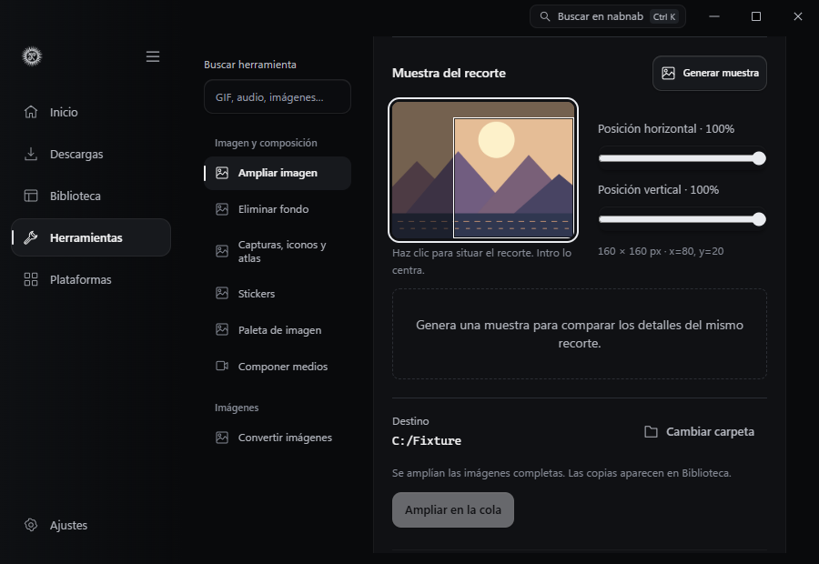
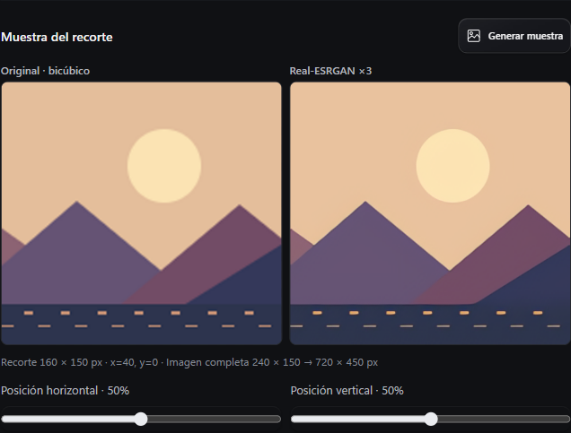
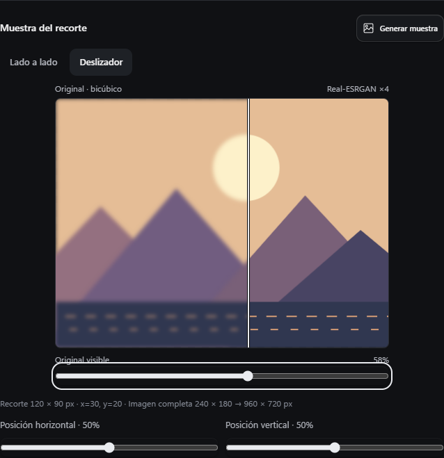

# Upscale images

In **Settings → Engines → Optional components**, install **Real-ESRGAN · ncnn Vulkan**. The Windows x64 package requires a Vulkan-compatible GPU and driver. The download is 45,474,481 bytes and the installed runtime and selected models total 43,636,188 bytes. The installer verifies SHA-256, extracts the executable, its OpenMP DLL and the supported model files, then clears the temporary ZIP. Disable the component to keep its files or remove it to reclaim the space.

Open **Tools → Image and composition → Upscale image**. Select up to 12 still PNG, JPEG or WebP images from Library. Choose the model and the factor it supports.

| Model | Scales |
| --- | --- |
| Photo · RealESRGAN x4plus | ×4 |
| Illustration · AnimeVideo v3 | ×2, ×3, ×4 |

Choose one image in the batch. Click the thumbnail to place the crop, or adjust the horizontal and vertical sliders with the arrow keys. Press **Enter** on the thumbnail to center the crop. The outline and coordinates show the area of up to 160 × 160 source pixels. The thumbnail uses the same stored pixel orientation as the upscale engine and counts toward the Library thumbnail cache limit.

Select **Generate preview**. The comparison shows the same crop at the same size, using bicubic interpolation on the left and Real-ESRGAN on the right. Fine details are inferred. Results can vary with the source and model.

Choose **Slider** to see the two images overlaid in the same frame. Move **Visible original** with the pointer or arrow keys. **Home** shows the processed crop and **End** shows the original. **Side by side** returns to the paired view. Both views use the same generated sample.

The memory estimate covers uncompressed input and output RGBA pixels. Additional Vulkan model and driver allocations vary. The 64 and 128 pixel tiles let you choose between lower GPU memory use and larger blocks. Upscaling uses one GPU task at a time and also takes a slot from nabnab's processing limit.

Review the destination and select **Queue upscale**. The queue checks the source fingerprint again and publishes a new PNG linked to each original in Library. Jobs process stored pixel orientation and accept inputs up to 64 MiB. The output limit is 8192 pixels per side and 24 million pixels total. Cancelling a preview or job stops its local processes.

The optional engine uses the pinned upstream Windows build from April 24, 2022. The runtime code is MIT, the Real-ESRGAN project that publishes the weights is BSD-3-Clause, and the Windows binary includes Microsoft's OpenMP runtime. Inference runs locally with the verified files, using Vulkan and the bundled FFmpeg for image preparation. [Pinned upstream package](https://github.com/xinntao/Real-ESRGAN/releases/tag/v0.2.5.0) · [Runtime license](https://github.com/xinntao/Real-ESRGAN-ncnn-vulkan/blob/v0.2.0/LICENSE) · [Real-ESRGAN license](https://github.com/xinntao/Real-ESRGAN/blob/master/LICENSE)

`node tests/native-upscale.browser.mjs --overview-only` tests the crop selector with a synthetic JPEG that carries EXIF rotation metadata. The test verifies the thumbnail orientation and crop coordinates in WebView2 without running the model. The Edge test checks pointer and keyboard placement at 900 and 1180 pixels using a simulated comparison.
