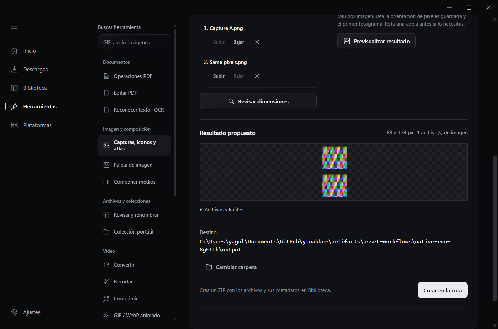
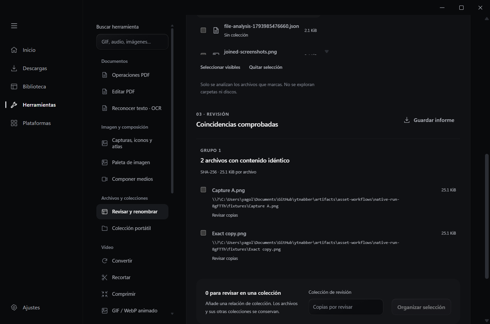
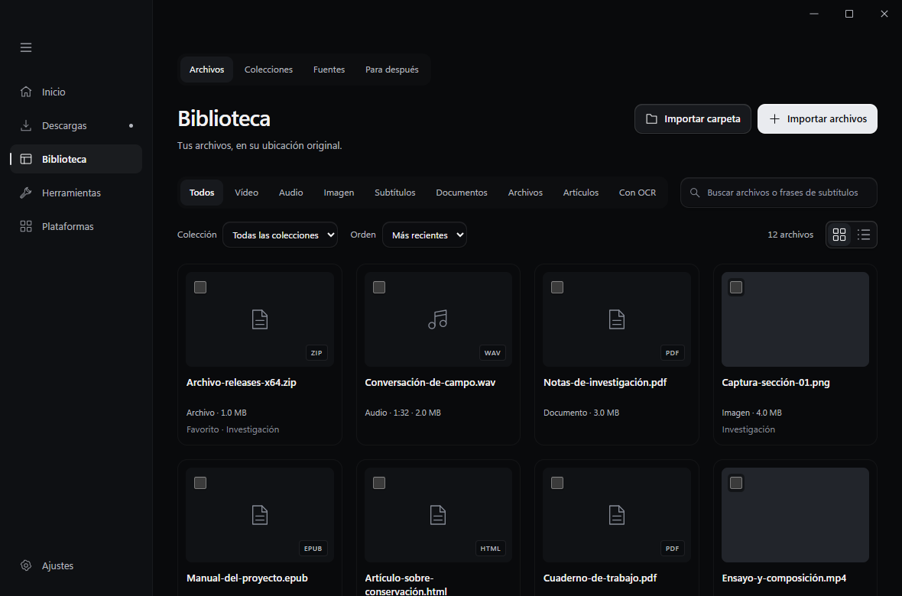
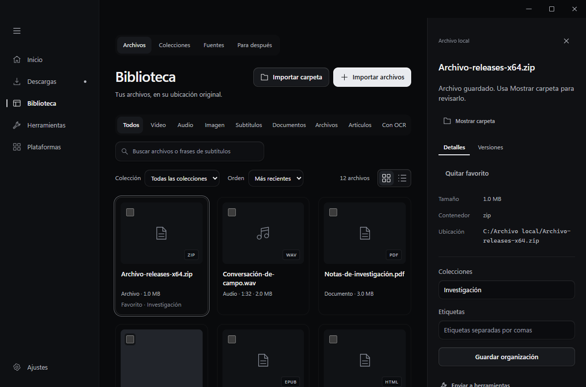
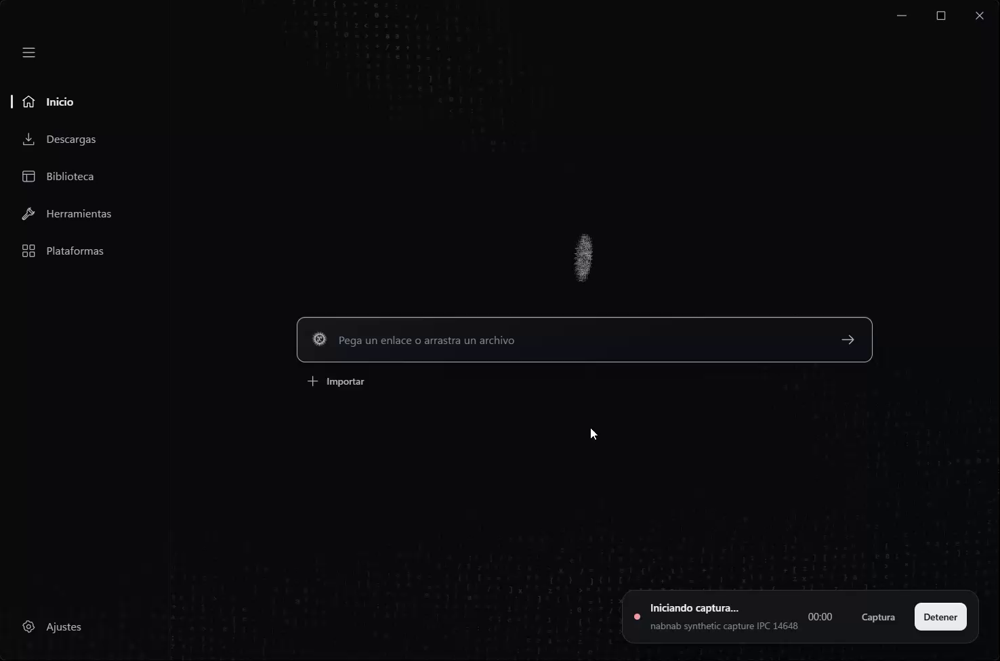
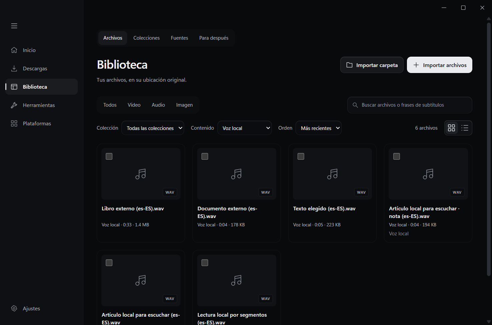
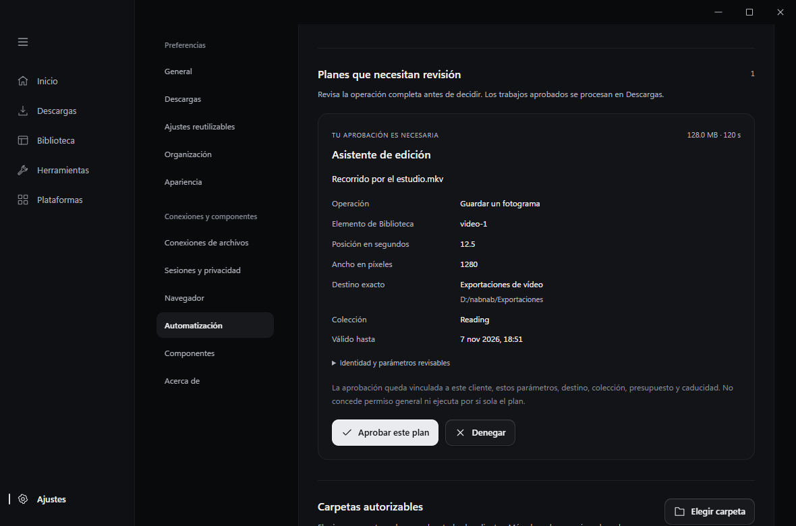

# Archivos online y nuevas herramientas locales

## Entrega A: fuentes y documentos

Inicio reconoce repositorios y releases de GitHub, ítems de Internet Archive, páginas de archivo/categorías de Commons y enlaces de Drive, OneDrive y Dropbox. También se accede desde Plataformas → Archivos y documentos. La exploración no inicia una descarga.

1. Abre el origen y, cuando corresponda, elige versión, ítem o carpeta.
2. Revisa los archivos cargados. La continuación y los avisos indican si el resultado es parcial.
3. Selecciona archivos, revisa el formato de exportación de documentos nativos y elige colección/destino.
4. Pulsa Añadir a Descargas. Los resultados pasan por la cola y aparecen en Biblioteca con su tipo real.

Los nombres repetidos generan una nueva versión local numerada. No se reemplazan archivos existentes. Los cambios de versión, tamaño o checksum en el origen requieren seleccionar de nuevo el archivo. Descargar software no lo ejecuta ni lo instala.

GitHub distingue estable y prerelease. Seguir versiones abre el formulario de consentimiento de Fuentes; la selección de archivos de cada release sigue siendo manual. Internet Archive distingue originales y derivados, conserva los derechos disponibles y excluye préstamos/restricciones. Commons conserva autor y licencia por archivo y genera una ficha JSON de atribución al lado de los archivos descargados.

Consulta [fuentes públicas](PUBLIC-SOURCES.md) para límites y pruebas con los servicios reales. Consulta [conexiones cloud](CLOUD-STORAGE.md) para registrar aplicaciones OAuth legítimas y configurar los permisos. No se distribuyen credenciales. Los conectores cloud están implementados y requieren configurar una aplicación y autorizar una cuenta antes de usarlos. No se ha probado una exportación con una cuenta real.

## Interfaz verificada

Las siguientes capturas usan IPC simulado. Muestran los formularios y estados renderizados, no certifican acceso a cuentas.

La verificación de navegador cubre 1180 × 780 y 900 × 620, selección, paginación, errores, cancelación, formatos de exportación y acceso desde Ajustes. Los documentos Office y de texto mantienen su clasificación y ofrecen apertura con el sistema; el lector interno sigue reservado a PDF/EPUB.

## Evidencia y alcance

- `tests/file-sources.browser.mjs`: recorridos de interfaz con IPC simulado, estados de error/cancelación y regresión del lector.
- `public_sources::tests::live_public_sources` y `live_public_downloads`: APIs reales, resolución reciente, descarga e indexación de muestras pequeñas de los tres orígenes públicos.
- `cloud_storage::tests`: PKCE, estado OAuth, permisos/endpoints, enlaces protegidos con DPAPI, transferencias HTTP locales y cancelación. No usan cuentas personales.
- `file_sources::tests` y pruebas de publicación: identidad/versiones, ausencia de URLs operativas en trabajos, nombres reservados y preservación de archivos anteriores.

Los informes de cada ejecución quedan en `artifacts/file-sources/`. Las restricciones de red, cuentas y hardware se mantienen separadas de los resultados con fixtures. No se obtuvo una captura anterior equivalente de la nueva pantalla, por lo que estas imágenes documentan el resultado final.

`tests/native-file-sources.browser.mjs` verificó también el recorrido completo en la aplicación real con datos aislados: tres descargas públicas y la ficha de Commons, cuatro trabajos completados y cuatro archivos indexados. Comprobó SHA-256 publicado de GitHub, metadatos de Commons incluidos los ausentes, colecciones, repetición idempotente y cancelación. El resultado está en [evidencia nativa](verification/online-file-sources-native.json). Se corrigieron las etiquetas de documento/archivo y la carga de miniaturas, y se reabrieron esos mismos resultados sin llamadas remotas para comprobar la corrección.

El test permite repetir solo la comprobación local con `NABNAB_NATIVE_REUSE_DATA` apuntando a una carpeta `artifacts/file-sources/native-run-*` generada por él. Una repetición de las APIs encontró errores 504 de GitHub; se registraron como fallos temporales y no se confundieron con trabajos completados.

## Entrega B: lectura y documentos

La extensión incorpora Guardar artículo, Guardar selección y Guardar página offline con previsualización y exportación HTML, EPUB o Markdown. El lector local permite notas y resaltados por versión. La [guía de archivo web](WEB-ARCHIVE.md) explica qué se conserva y qué se omite.

En Herramientas, el directorio permite elegir Operaciones PDF, Editar PDF y Reconocer texto sin recorrer todos los formularios. [OCR](OCR.md) añade imágenes, regiones y PDF escaneados, copia buscable, revisión y corrección de texto, búsqueda con coordenadas y retirada del índice. Tesseract y sus idiomas son componentes opcionales. [Edición PDF](DOCUMENT-EDITS.md) añade compresión, márgenes, numeración, marca de agua e índice jerárquico, con previsualización vinculada a la entrada y opciones elegidas. Cada resultado conserva el original.

La aplicación nativa completó siete trabajos y dejó nueve archivos de biblioteca en datos de prueba aislados. Se verificaron OCR, PDF buscable, búsqueda global que abre la página reconocida, texto corregido exportado, consentimiento y parámetros de previsualización PDF, archivo web autenticado, notas por versión y EPUB. Los motores y entradas sintéticas se prepararon para las pruebas; no se modificó una instalación del usuario. Consulta la [evidencia nativa](verification/document-workflows-native.json).

El acabado de Descargas, Herramientas, Plataformas y Ajustes también cambia la composición, las superficies y la jerarquía de controles. Las referencias y reglas siguen en [la fuente de diseño canónica](design-reference.md). Estas comparaciones usan ventanas y fixtures equivalentes:

## Entrega C: archivos e imágenes

Herramientas organiza estas operaciones en Imagen y composición y Archivos y colecciones, dentro del mismo directorio. Biblioteca permite enviar una selección a revisión o exportación.

[Revisar y renombrar](FILE-ORGANIZATION.md) distingue copias exactas por SHA-256 de parecidos visuales estimados. Permite comparar lado a lado y reunir resultados en una colección de revisión. El renombrado muestra el mapa de nombres antes de aplicarlo, conserva identificadores y relaciones y ofrece historial para continuar o deshacer. Una colisión posterior no se sobrescribe; un resultado parcial exige revisión.

[Capturas, iconos y atlas](IMAGE-ASSETS.md) añade unión vertical con cortes corregibles, PNG e ICO con transparencia o fondo elegido, separación de cuadrículas y hojas con atlas JSON. La previsualización queda vinculada a imágenes y opciones. Las operaciones producen archivos nuevos mediante la cola.

[Colección portable](PORTABLE-COLLECTIONS.md) permite exportar un ZIP con manifiesto, metadatos y notas elegidas; OCR es opcional. La importación revisa tamaño, contenido idéntico, rutas relativas y límites del paquete antes de copiarlo al destino autorizado. Los artículos se regeneran desde su captura validada.

El recorrido de tests/native-asset-workflows.browser.mjs usa la aplicación, motores, cola y disco reales con imágenes sintéticas y datos aislados. Comprueba SHA-256, parecido visual, colección de revisión, informe, unión, atlas, iconos, aprobación de vista previa, renombrado/deshacer, colisiones tardías y exportación/importación con deduplicación. Los originales mantienen sus hashes. [Resultados estructurados](verification/asset-workflows-native.json).

La biblioteca y el inspector también se refinan; estas dos capturas usan fixtures de IPC:

## Entrega D: pantalla y voz

[Pantalla y repetición](SCREEN-CAPTURE.md) incorpora selección explícita de ventana, pantalla o región, vista previa y audio del sistema/micrófono separados y desactivados inicialmente. La grabación empieza directamente y conserva segmentos recuperables; el resultado pasa por Descargas y Biblioteca. Un indicador permanece visible al cambiar de sección, con tiempo y botón de detener. El búfer de 30, 60 o 120 segundos requiere activación expresa y muestra su límite de disco; su atajo solo guarda tiempo que ya se haya capturado.

Las ventanas aceleradas utilizan Windows Graphics Capture. La prueba integrada exige contenido visible en la vista previa, PNG y vídeo; ya no acepta una superficie uniforme solo porque el contenedor sea válido. El reproductor nativo cargó los metadatos del MKV real, sin iniciar reproducción. Se comprobaron destino fijado al comenzar, controles globales, liberación del atajo y recuperación parcial explícita. [Siete grupos nativos](verification/capture-native.json).

[Voz local](LOCAL-VOICE.md) usa voces Microsoft Desktop instaladas en Windows, sin servicio remoto ni descarga oculta. Permite elegir texto, artículo, nota, TXT, PDF o EPUB; revisar la fuente y configuración; oír una muestra; generar por segmentos, pausar y reanudar desde la caché. La salida WAV conserva capítulos con tiempos reales y procedencia. Los nombres usan el título y el idioma para facilitar su lectura en Biblioteca.

El recorrido nativo generó muestras con Helena y Zira y resultados relacionados con cinco tipos de fuente. Verificó 40 segmentos, pausa y reanudación conservando los bytes de la caché, y rechazo de una nota asociada a otra versión del artículo. No se reprodujeron altavoces ni se capturó audio personal. [Cuatro grupos nativos de voz](verification/voice-native.json).

Biblioteca añade filtros de grabaciones y narraciones al selector de contenido existente. Herramientas conserva su directorio y búsqueda al actualizar estos estados. Ajustes mantiene visible su navegación al recorrer formularios largos.

## Entrega E: automatización autorizada

[CLI y MCP local](LOCAL-AUTOMATION.md) utilizan una tubería privada de Windows para hablar con la aplicación abierta o con un trabajador iniciado expresamente desde la CLI. Solo uno puede poseer la cola y el repositorio. El MCP emplea el SDK Rust oficial fijado y transporte stdio. La función está desactivada inicialmente; cada cliente necesita autorización local, capacidades, colecciones y destinos elegidos expresamente.

Preparar un plan no lo ejecuta. Ajustes → Automatización muestra operación, entrada, destino, colección, límites y caducidad para aprobar o denegar. Después, el cliente puede consumir una vez ese identificador; no puede sustituir parámetros al encolarlo. La revocación y los límites se vuelven a comprobar al ejecutar y antes de publicar.

Las respuestas omiten texto completo, rutas privadas, tokens y sesiones. Los documentos necesitan un permiso adicional para sus metadatos. El catálogo inicial permite archivos multimedia HTTP directos, extracción local a MP3/M4A y fotogramas; no incluye shell, rutas libres, instalación, grabación o micrófono. Un cliente de IA externo puede reenviar a su proveedor los resultados recibidos; el transporte local no evita esa acción.

La interfaz de permisos y revisión está renderizada a 1180 × 780 y 900 × 620 con fixtures de IPC. El recorrido nativo verificó la autorización inicial, el aislamiento de colecciones, una extracción MP3 y un fotograma PNG, el rechazo de una salida que supera el límite, la revocación de una sesión MCP en curso y la ejecución de un plan aprobado desde el trabajador sin ventana. [Cuatro grupos nativos](verification/automation-native.json).

