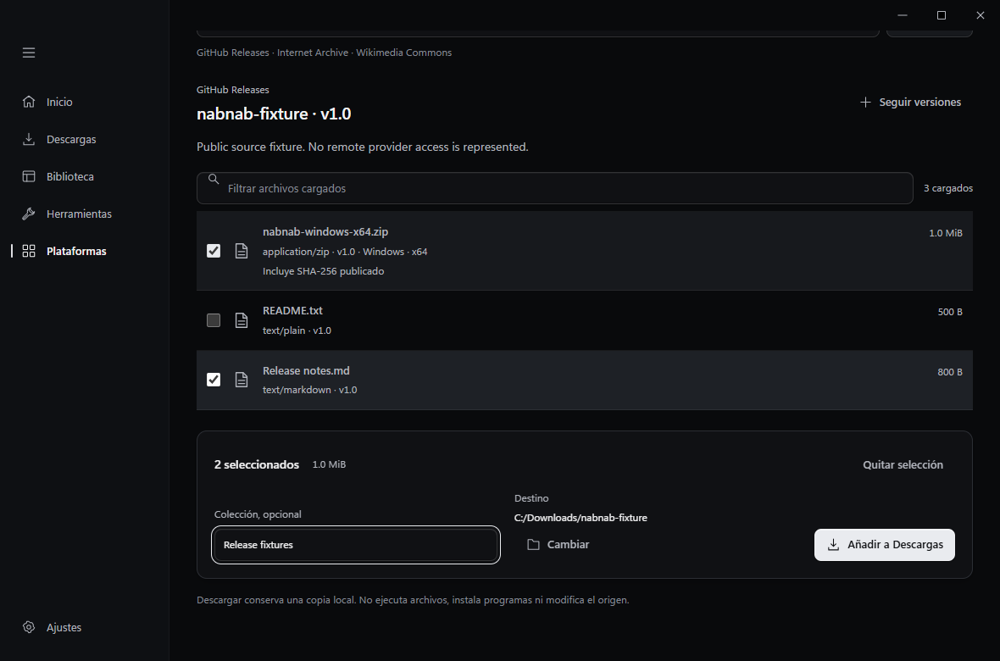
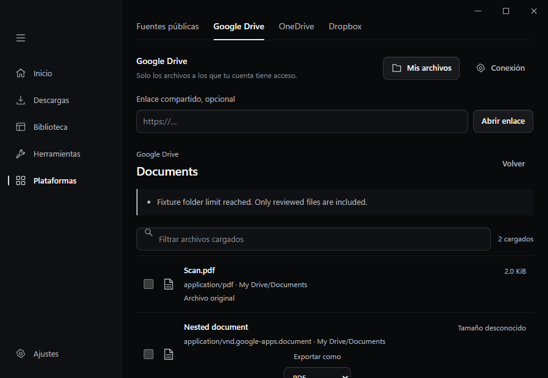
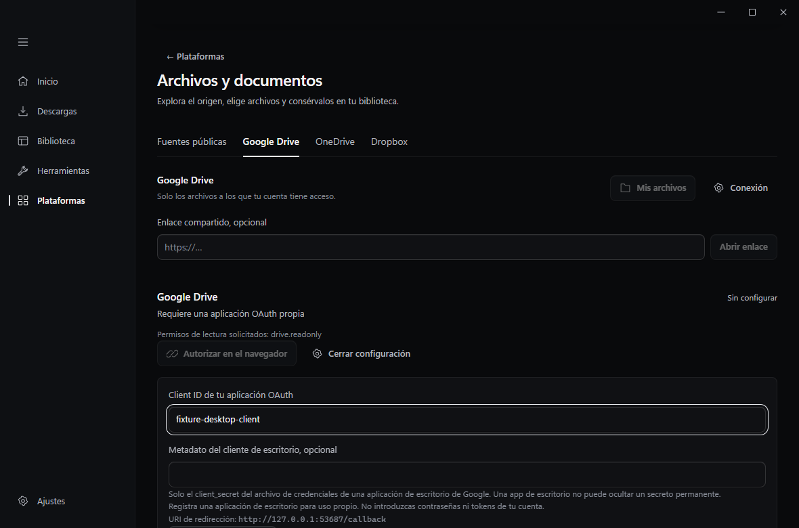
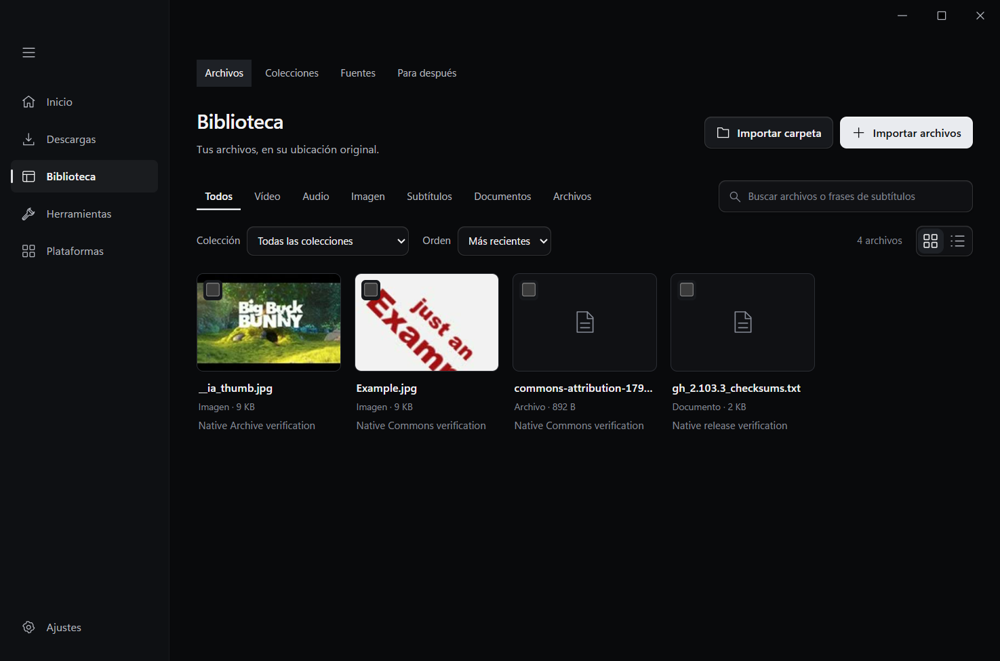
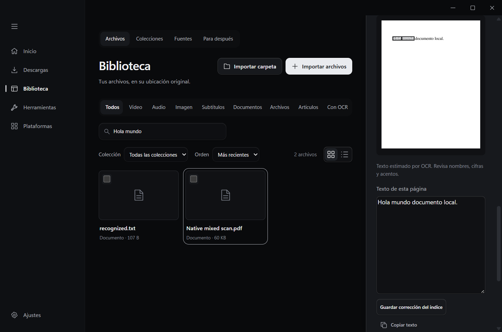
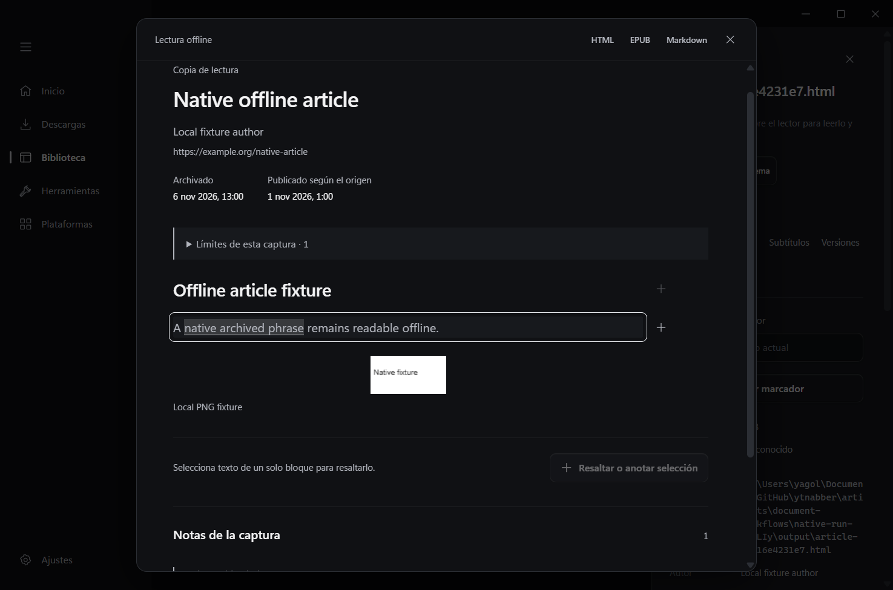
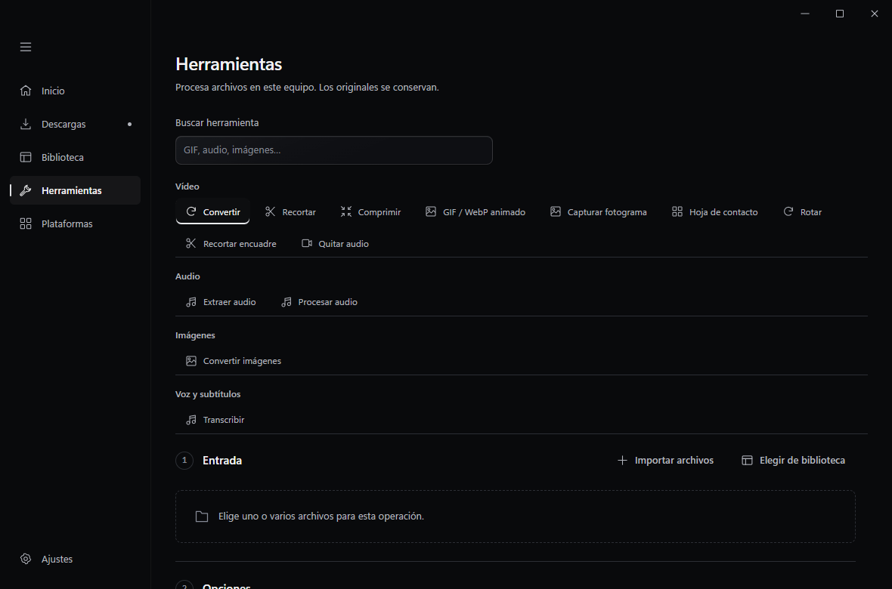
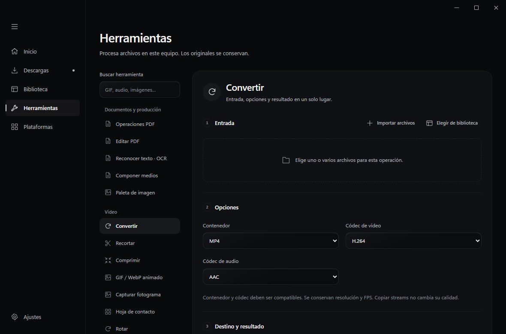
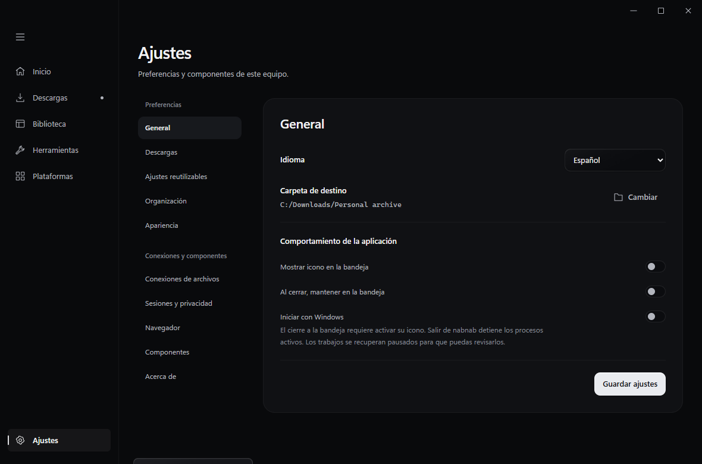

# Archivos online y nuevas herramientas locales

## Entrega A: fuentes y documentos

Inicio reconoce repositorios y releases de GitHub, ítems de Internet Archive, páginas de archivo/categorías de Commons y enlaces de Drive, OneDrive y Dropbox. También se accede desde Plataformas → Archivos y documentos. La exploración no inicia una descarga.

1. Abre el origen y, cuando corresponda, elige versión, ítem o carpeta.
2. Revisa los archivos cargados. La continuación y los avisos indican si el resultado es parcial.
3. Selecciona archivos, revisa el formato de exportación de documentos nativos y elige colección/destino.
4. Pulsa Añadir a Descargas. Los resultados pasan por la cola y aparecen en Biblioteca con su tipo real.

Los nombres repetidos generan una nueva versión local numerada. No se reemplazan archivos existentes. Los cambios de versión, tamaño o checksum en el origen requieren seleccionar de nuevo el archivo. Descargar software no lo ejecuta ni lo instala.

GitHub distingue estable y prerelease. Seguir versiones abre el formulario de consentimiento de Fuentes; la selección de archivos de cada release sigue siendo manual. Internet Archive distingue originales y derivados, conserva los derechos disponibles y excluye préstamos/restricciones. Commons conserva autor y licencia por archivo y genera una ficha JSON de atribución al lado de los archivos descargados.

Consulta [fuentes públicas](PUBLIC-SOURCES.md) para límites y pruebas con los servicios reales. Consulta [conexiones cloud](CLOUD-STORAGE.md) para registrar aplicaciones OAuth legítimas y configurar los permisos. No se distribuyen credenciales. Los conectores cloud están implementados y requieren configurar una aplicación y autorizar una cuenta antes de usarlos. No se ha probado una exportación con una cuenta real.

## Interfaz verificada

Las siguientes capturas usan IPC simulado. Muestran los formularios y estados renderizados, no certifican acceso a cuentas.

La verificación de navegador cubre 1180 × 780 y 900 × 620, selección, paginación, errores, cancelación, formatos de exportación y acceso desde Ajustes. Los documentos Office y de texto mantienen su clasificación y ofrecen apertura con el sistema; el lector interno sigue reservado a PDF/EPUB.

## Evidencia y alcance

- `tests/file-sources.browser.mjs`: recorridos de interfaz con IPC simulado, estados de error/cancelación y regresión del lector.
- `public_sources::tests::live_public_sources` y `live_public_downloads`: APIs reales, resolución reciente, descarga e indexación de muestras pequeñas de los tres orígenes públicos.
- `cloud_storage::tests`: PKCE, estado OAuth, permisos/endpoints, enlaces protegidos con DPAPI, transferencias HTTP locales y cancelación. No usan cuentas personales.
- `file_sources::tests` y pruebas de publicación: identidad/versiones, ausencia de URLs operativas en trabajos, nombres reservados y preservación de archivos anteriores.

Los informes de cada ejecución quedan en `artifacts/file-sources/`. Las restricciones de red, cuentas y hardware se mantienen separadas de los resultados con fixtures. No se obtuvo una captura anterior equivalente de la nueva pantalla, por lo que estas imágenes documentan el resultado final.

`tests/native-file-sources.browser.mjs` verificó también el recorrido completo en la aplicación real con datos aislados: tres descargas públicas y la ficha de Commons, cuatro trabajos completados y cuatro archivos indexados. Comprobó SHA-256 publicado de GitHub, metadatos de Commons incluidos los ausentes, colecciones, repetición idempotente y cancelación. El resultado está en [evidencia nativa](verification/online-file-sources-native.json). Se corrigieron las etiquetas de documento/archivo y la carga de miniaturas, y se reabrieron esos mismos resultados sin llamadas remotas para comprobar la corrección.

El test permite repetir solo la comprobación local con `NABNAB_NATIVE_REUSE_DATA` apuntando a una carpeta `artifacts/file-sources/native-run-*` generada por él. Una repetición de las APIs encontró errores 504 de GitHub; se registraron como fallos temporales y no se confundieron con trabajos completados.

## Entrega B: lectura y documentos

La extensión incorpora Guardar artículo, Guardar selección y Guardar página offline con previsualización y exportación HTML, EPUB o Markdown. El lector local permite notas y resaltados por versión. La [guía de archivo web](WEB-ARCHIVE.md) explica qué se conserva y qué se omite.

En Herramientas, el directorio permite elegir Operaciones PDF, Editar PDF y Reconocer texto sin recorrer todos los formularios. [OCR](OCR.md) añade imágenes, regiones y PDF escaneados, copia buscable, revisión y corrección de texto, búsqueda con coordenadas y retirada del índice. Tesseract y sus idiomas son componentes opcionales. [Edición PDF](DOCUMENT-EDITS.md) añade compresión, márgenes, numeración, marca de agua e índice jerárquico, con previsualización vinculada a la entrada y opciones elegidas. Cada resultado conserva el original.

La aplicación nativa completó siete trabajos y dejó nueve archivos de biblioteca en datos de prueba aislados. Se verificaron OCR, PDF buscable, búsqueda global que abre la página reconocida, texto corregido exportado, consentimiento y parámetros de previsualización PDF, archivo web autenticado, notas por versión y EPUB. Los motores y entradas sintéticas se prepararon para las pruebas; no se modificó una instalación del usuario. Consulta la [evidencia nativa](verification/document-workflows-native.json).

El acabado de Descargas, Herramientas, Plataformas y Ajustes también cambia la composición, las superficies y la jerarquía de controles. Las referencias y reglas siguen en [la fuente de diseño canónica](design-reference.md). Estas comparaciones usan ventanas y fixtures equivalentes:

## Entregas siguientes

C, organización e imágenes; D, captura/voz; E, CLI/MCP y permisos siguen pendientes de implementación. Esta guía se actualizará al cerrar sus recorridos. Las funciones de fases anteriores no se contabilizan como novedades.
