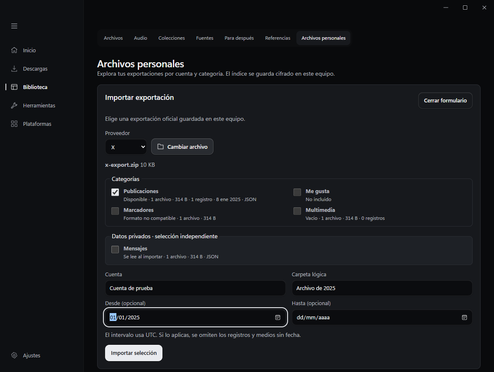
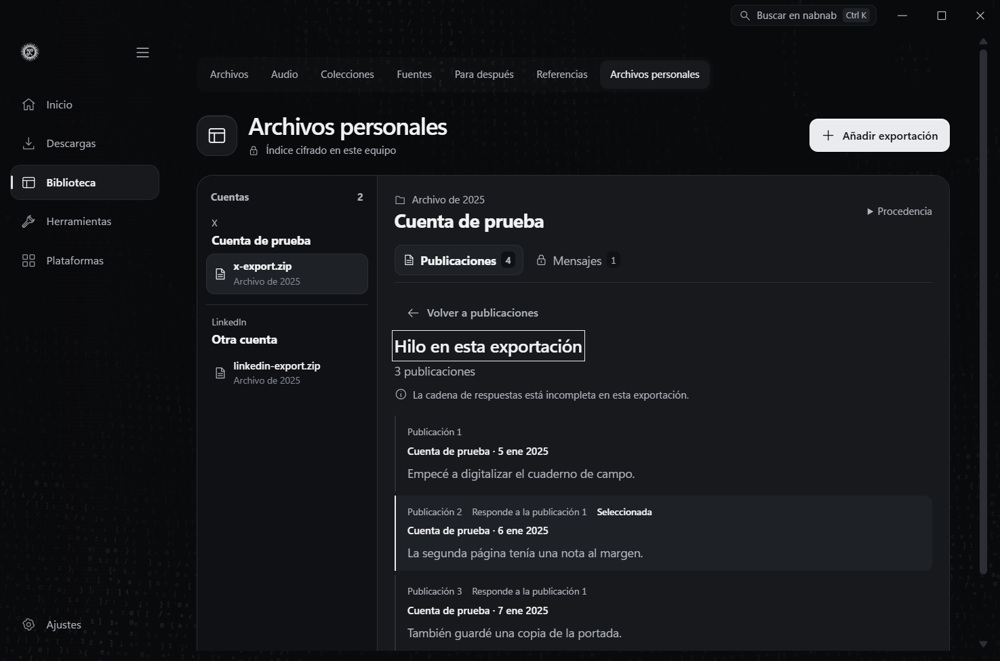
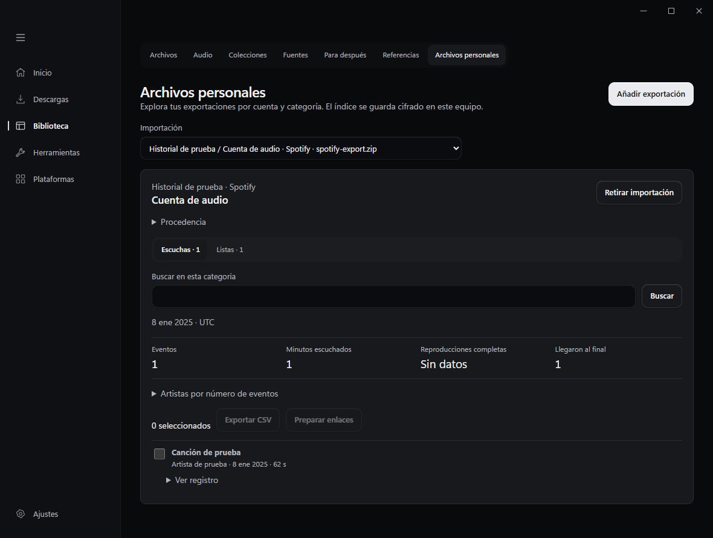
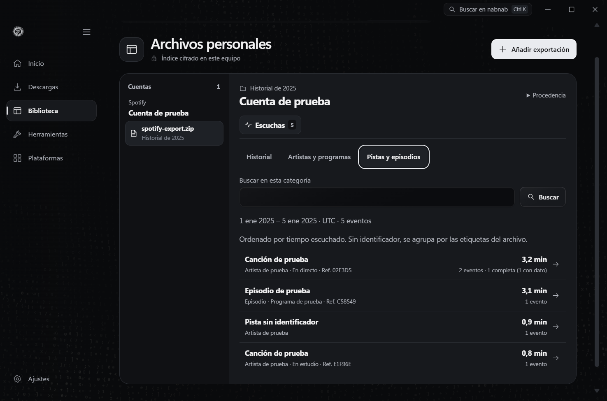

# Personal archives

Open **Library → Personal archives → Add export**, choose the provider, and select a ZIP or a recognized loose JSON, CSV, or HTML file. The preview shows the files and volume by category and gives record counts and dates when it can read the format. Enter an account label and archive group, then choose which categories to import. An optional UTC date interval includes both dates and skips undated records and media.

| Provider | Recognized content |
| --- | --- |
| Instagram and Facebook | Posts, saved items, media from recognized folders, and separately selected contacts and messages. JSON has the most detail. HTML is indexed as plain text, one record per document. |
| X | Posts and local threads, likes, bookmarks, and media when present. The ZIP reader accepts known X data assignments as JSON. Direct messages require separate selection. |
| Spotify | Basic or extended listening history and exported playlists. Listening separates events, elapsed time, reported track endings, and plays with enough information to establish completion. **Match in Audio** opens the local playlist review. |
| LinkedIn | Contacts, posts, and messages from recognized CSV and JSON layouts. Contacts and messages require separate selection. |

The account index groups exports by provider and account and lists each package with its archive group. Open a package and select a category in the workspace. Search applies to that category. Use the row checkboxes to export a selection to CSV or open its public links in the batch preparer. Selecting **Prepare links** starts metadata preparation. Downloading from that batch requires a separate action.

Select **Preview** on an image or video in **Media**. The preview shows the image or the first frame of a video and keeps the source and **Save copy** action within reach. **Back to records** or **Esc** restores the search, selection, and keyboard focus. Audio remains available through **Save copy**. Media in a private category requires opening that category first.

The preview uses the installed FFmpeg engine. It decodes only the selected local file through an inherited file descriptor and keeps the resulting JPEG in memory while the preview is open. [FFmpeg input protocols](https://raw.githubusercontent.com/FFmpeg/FFmpeg/master/doc/protocols.texi)

For an X post with a recorded reply relationship, open **View thread**. Nabnab follows the reply identifiers within that export and shows the related posts in pages of up to 50, with the chosen post marked. A missing parent is indicated as an incomplete chain. **Back to posts** restores the search, selection, and focus. This also works with previously imported exports that contain reply identifiers.

In **Listening**, switch between **History**, **Artists and shows**, and **Tracks and episodes**. The summaries rank named entries by recorded listening time. Select an entry to view its events, date range, minutes, and the number of complete plays where the export supplies enough information. Entries with a Spotify track or episode URI are grouped by that identifier. Entries without one use the available labels, including album or show when present. You can reimport the same export to recover missing identifiers in an older index without duplicating its events.

Contacts and messages require explicit selection at import and explicit reveal when browsing. Private CSV export asks for confirmation and writes readable text to the chosen destination. The archive index uses Windows DPAPI. Managed media resides in a user-restricted local directory and can be copied out with **Save copy**. Personal archives live outside the ordinary Library index used by global search, portable collections, CLI, and MCP.

Reimporting the same SHA-256 package under the same provider and account adds missing records and categories. Open **Provenance → Remove import** to delete the indexed records and managed media copies while preserving the source export.

ZIP processing uses the Windows ZIP reader and validates paths before extraction. The source limit is 1 GiB, with up to 10,000 entries, 24 path components, and 2 GiB of declared expanded data. A selection can extract up to 256 MiB, including up to 32 MiB of metadata. Media storage is limited to 2 GiB across imports. Archives with unknown filenames or schemas may have missing or unsupported categories. Exporting a narrower set of data can help with size limits.

Provider documentation on requesting an export

- [Meta Accounts Center](https://accountscenter.facebook.com/info_and_permissions/)
- [X archive](https://help.x.com/en/managing-your-account/how-to-download-your-x-archive)
- [Spotify data formats](https://support.spotify.com/article/understanding-your-data/)
- [LinkedIn account data](https://www.linkedin.com/help/linkedin/answer/a1339364)

Verification uses synthetic exports. The Windows tests exercise selective ZIP extraction, repeat and partial imports, DPAPI storage, removal, and reply chains with branches, missing parents, or cycles. Native WebView2 checks opened a thread from a previously indexed fixture and distinguished same-title Spotify recordings, including exact drilldown, album search, and legacy rows without an identifier. The Edge test exercises return focus at 900 and 1180 pixels, account grouping, private reveal, CSV confirmation, and the handoff to Audio.
