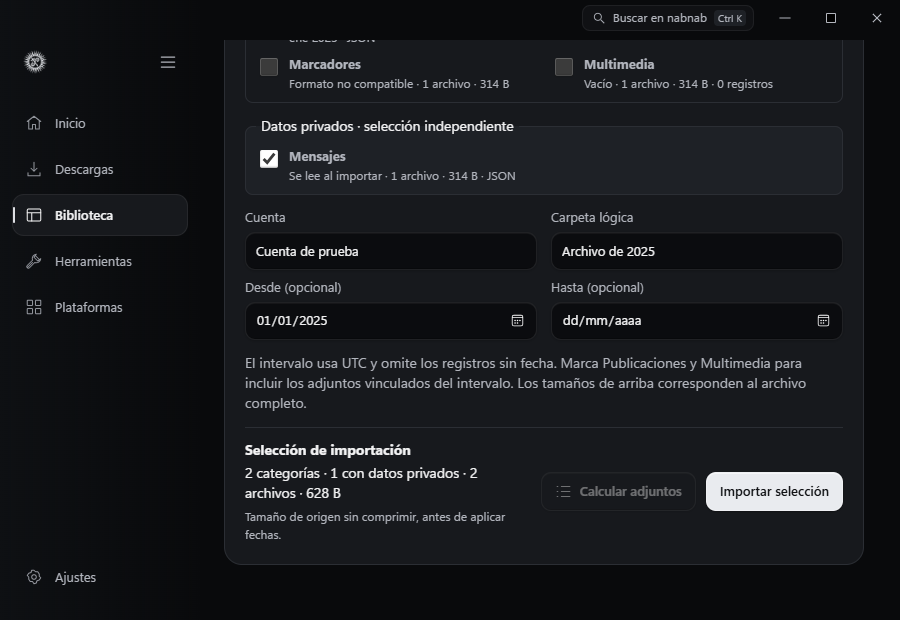
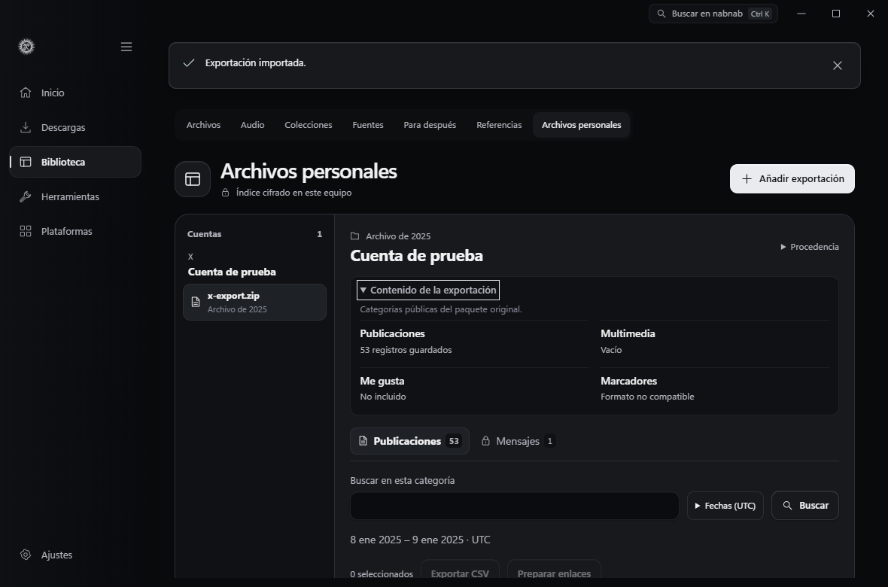
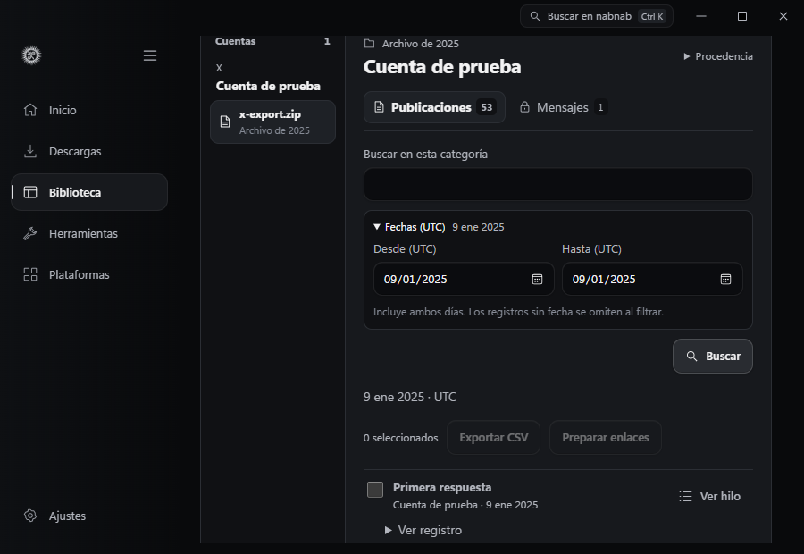
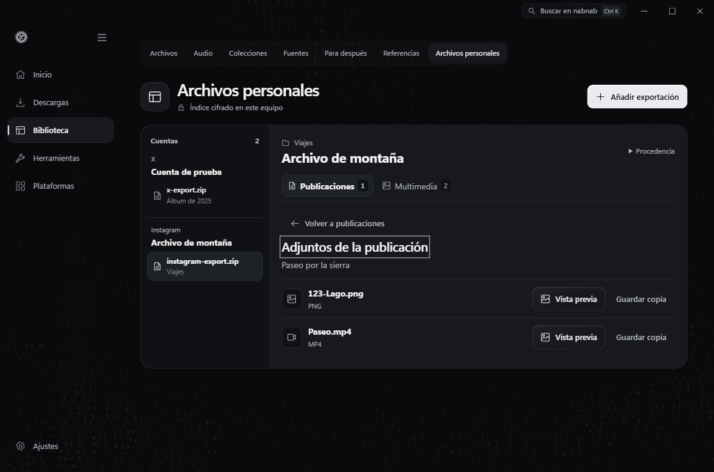
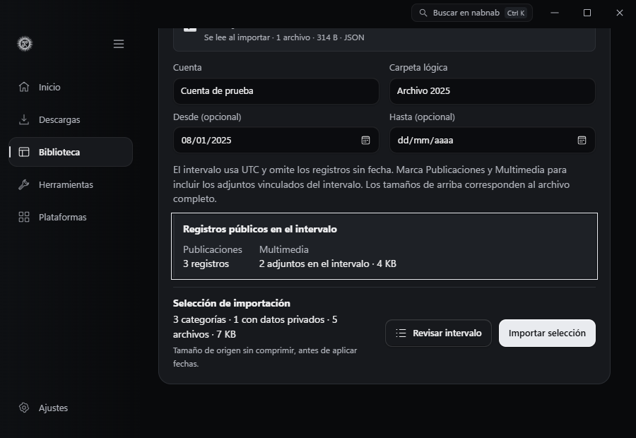

# Personal archives

Open **Library → Personal archives → Add export**, choose the provider, and select a ZIP or a recognized loose JSON, CSV, or HTML file. The preview shows the files and volume by category before filtering and gives record counts and dates when it can read the format. Enter an account label and archive group, then choose which categories to import. An optional UTC date interval includes both dates and skips undated records.

The import footer totals the selected categories and flags any private categories you selected. Its file count and uncompressed size come from the source before date filtering. The preview shows how many files it already knows it will skip in a mixed category, including recognized filenames whose contents use an unsupported format. A category with a data file over 8 MiB is unavailable. You can still select other categories in the same export. Private records are read only after you explicitly select and import their category. The separate attachment calculation reports the media linked to posts in the chosen interval.

| Provider | Recognized content |
| --- | --- |
| Instagram and Facebook | Posts, saved items, media from recognized folders, and separately selected contacts and messages. JSON has the most detail. HTML is indexed as plain text, one record per document. |
| X | Posts and local threads, likes, bookmarks, and media when present. The ZIP reader accepts known X data assignments as JSON. Direct messages require separate selection. |
| Spotify | Basic or extended listening history and exported playlists. Listening separates events, elapsed time, reported track endings, and plays with enough information to establish completion. **Match in Audio** opens the local playlist review. |
| LinkedIn | Contacts, posts, and messages from recognized CSV and JSON layouts. Contacts and messages require separate selection. |

The account index groups exports by provider and account and lists each package with its archive group. Open a package and select a category in the workspace. Search applies to that category. Use the row checkboxes to export a selection to CSV or open its public links in the batch preparer. Selecting **Prepare links** starts metadata preparation. Downloading from that batch requires a separate action.

Open **Export contents** to compare what you saved with the public categories found in the original package. The summary distinguishes categories that are available to import, empty, missing from the package, or in an unsupported format. It reflects the package as inspected before any date filter. For an older index, preview the original file again to see those details.

Open **Dates (UTC)** in the category search to browse an imported period. Either date can be blank. The filter includes both days and omits undated records. Changing the period clears the row selection. Spotify history and its grouped totals use the same period.

Select **Preview** on an image or video in **Media**. The preview shows the image or the first frame of a video and keeps the source and **Save copy** action within reach. **Back to records** or **Esc** restores the search, selection, and keyboard focus. Audio remains available through **Save copy**. Media in a private category requires opening that category first.

The preview uses the installed FFmpeg engine. It decodes only the selected local file through an inherited file descriptor and keeps the resulting JPEG in memory while the preview is open. [FFmpeg input protocols](https://raw.githubusercontent.com/FFmpeg/FFmpeg/master/doc/protocols.texi)

For an X post with a recorded reply relationship, open **View thread**. Nabnab follows the reply identifiers within that export and shows the related posts in pages of up to 50, with the chosen post marked. A missing parent is indicated as an incomplete chain. **Back to posts** restores the search, selection, and focus. This also works with previously imported exports that contain reply identifiers.

An X post with matching local media shows an attachment count in the posts list and in the thread. Open it to preview or save the matching files. Nabnab matches an exact numeric post ID at the start of the filename in a recognized post media folder in the same import. You can add the Media category by reimporting the same package. Unmatched files stay in **Media**. Attachments from private messages stay in their own category.

For Instagram and Facebook JSON exports, select **Posts** and **Media** to see available photos and videos on their post, in export order. Select the attachment count to open the existing preview and save controls. Nabnab reads up to 64 references per post from `media[].uri` or `attachments[].data[].media.uri` and matches the exact path of a file imported into **Media** from the same package. Reimport the original ZIP with both categories to add the links to an older import. Unmatched files remain in **Media**. Private message media stays in **Messages**.

When filtering an X, Instagram or Facebook ZIP by date, select **Posts** and **Media** to copy the attachments linked to posts in that interval. Loose media, attachments from other dates and undated private media are skipped. Importing a narrower interval adds to the previous import of the same package. To copy loose media, import its category without a date interval.

Select **Review date range** to count matching records in each selected public category. For linked attachments, the review shows their count and uncompressed size, including files copied by an earlier import. The review reads the selected public metadata and leaves messages and contacts for the confirmed import. It also reports files it will skip. Changing the dates or a public category clears the result.

In **Listening**, switch between **History**, **Artists and shows**, and **Tracks and episodes**. The summaries rank named entries by recorded listening time. Select an entry to view its events, date range, minutes, and the number of complete plays where the export supplies enough information. Entries with a Spotify track or episode URI are grouped by that identifier. Entries without one use the available labels, including album or show when present. You can reimport the same export to recover missing identifiers in an older index without duplicating its events.

Contacts and messages require explicit selection at import and explicit reveal when browsing. Private CSV export asks for confirmation and writes readable text to the chosen destination. The archive index uses Windows DPAPI. Managed media resides in a user-restricted local directory and can be copied out with **Save copy**. Personal archives live outside the ordinary Library index used by global search, portable collections, CLI, and MCP.

Reimporting the same SHA-256 package under the same provider and account adds missing records and categories. Open **Provenance → Remove import** to delete the indexed records and managed media copies while preserving the source export.

ZIP processing uses the Windows ZIP reader and validates paths before extraction. The source limit is 1 GiB, with up to 10,000 entries, 24 path components, and 2 GiB of declared expanded data. A selection can extract up to 256 MiB, including up to 32 MiB of metadata. Media storage is limited to 2 GiB across imports. Archives with unknown filenames or schemas may have missing or unsupported categories. Exporting a narrower set of data can help with size limits.

Provider documentation on requesting an export

- [Meta Accounts Center](https://accountscenter.facebook.com/info_and_permissions/)
- [X archive](https://help.x.com/en/managing-your-account/how-to-download-your-x-archive)
- [Spotify data formats](https://support.spotify.com/article/understanding-your-data/)
- [LinkedIn account data](https://www.linkedin.com/help/linkedin/answer/a1339364)

Verification uses synthetic exports. The Windows tests exercise selective ZIP extraction, repeat and partial imports, DPAPI storage, removal, and reply chains with branches, missing parents, or cycles. Native WebView2 checks opened a thread from a previously indexed fixture and distinguished same-title Spotify recordings, including exact drilldown, album search, and legacy rows without an identifier. The Edge test exercises return focus at 900 and 1180 pixels, account grouping, private reveal, CSV confirmation, and the handoff to Audio.

The Facebook ZIP fixture verifies that the post keeps its identity across imports and that a same-name file from a different folder, an absent file, and a private photo stay out of its attachments. The native Instagram fixture verifies the attachment order, image decoding, and focus restoration at 900 and 1180 pixels.

The Windows date-range tests use synthetic X and Facebook ZIPs. They check the matching post count, attachment size, skipped files, and rejection of private categories in the review. They also check exclusion of an orphan and an attachment from the following day, preservation of a previous private import, and unchanged media size after repeating the same dated selection. The date review was checked in Edge with simulated archive data at both window widths.
