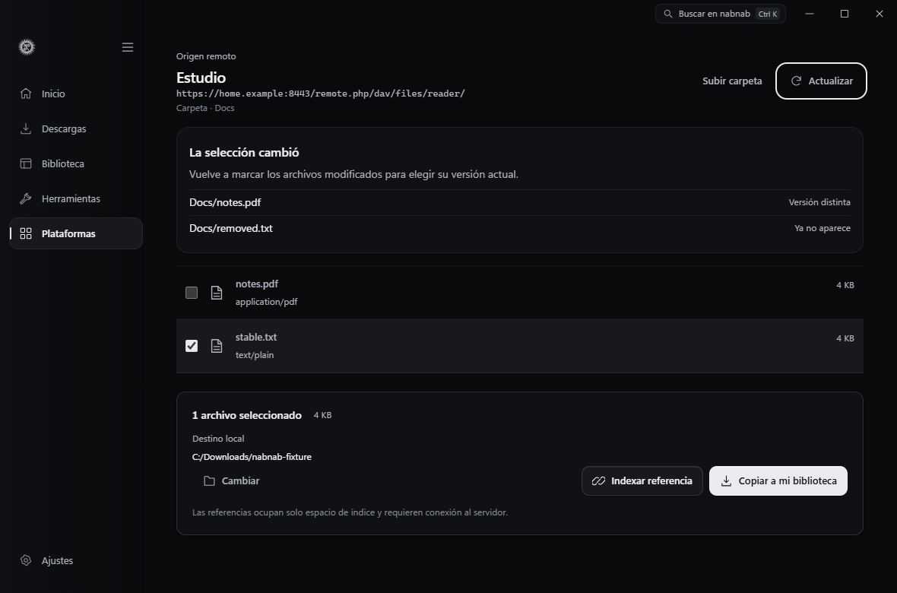
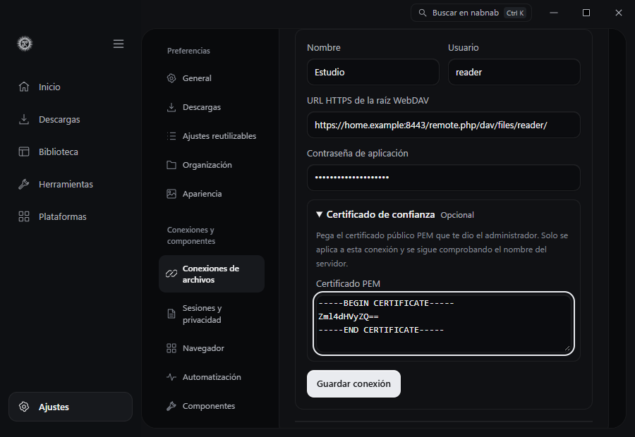
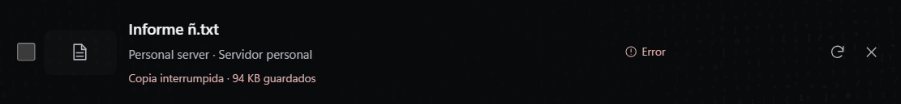
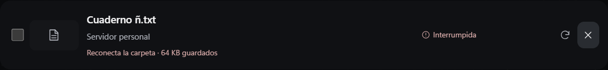
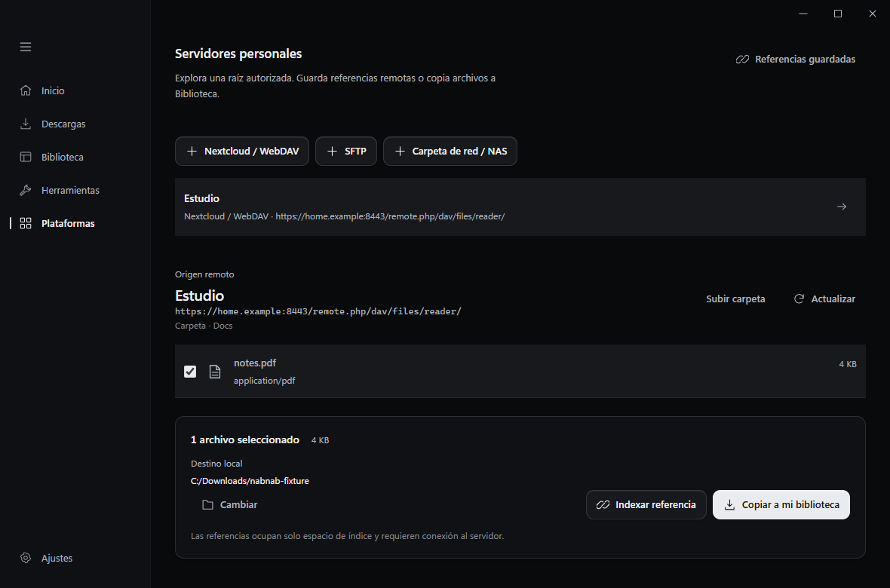
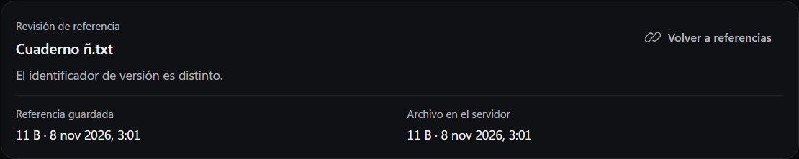
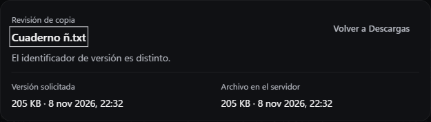

# Servidores personales

Abre **Plataformas → Archivos y documentos → Servidores personales**. Las conexiones también se pueden gestionar en **Ajustes → Conexiones**.

- **Nextcloud / WebDAV.** Indica la URL HTTPS de la carpeta autorizada, el usuario y una contraseña de aplicación. En Nextcloud, copia la URL WebDAV desde los ajustes de Archivos. Por defecto se usan los certificados de confianza de Windows. Para un servidor con una CA privada, abre **Certificado de confianza** y pega el certificado público PEM proporcionado por el administrador. Se usa solo para esa conexión y se verifica también el nombre del servidor. Si cambia el certificado de confianza, verifica el nuevo, desconecta la conexión anterior y vuelve a guardarla. Las credenciales se guardan con DPAPI.
- **SFTP.** Indica host, puerto, usuario y raíz absoluta. Elige una clave privada local que funcione sin interacción con el cliente OpenSSH de Windows. Compara la huella SHA-256 mostrada con la que te haya dado el administrador antes de guardarla. Un cambio de clave detiene la conexión. Verificar y sustituir la identidad del servidor exige retirar primero la conexión anterior.
- **Carpeta de red / NAS.** Elige una carpeta con el selector nativo. Admite carpetas montadas y rutas UNC ya accesibles con la sesión de Windows. Una unidad de red se guarda como su ruta UNC para conservar la identidad de la ubicación aunque cambie la letra asignada.

Abre la conexión, navega por carpetas y marca archivos. **Indexar referencia** guarda los metadatos en **Biblioteca → Referencias**. Una referencia depende del servidor y no contiene una copia. **Copiar a mi biblioteca** muestra el destino y envía la selección a Descargas. Las referencias guardadas también ofrecen **Obtener copia local**.

Si pulsas **Actualizar** en la carpeta, se conservan las marcas cuyos metadatos visibles coinciden con el listado anterior, aunque cambie el orden. Los archivos modificados o ausentes quedan fuera de la selección. Vuelve a marcar un archivo modificado para elegir la versión actual. Si la carpeta está inaccesible, puedes actualizar de nuevo para recuperar las marcas que todavía coincidan. Al copiar o indexar, nabnab comprueba que los metadatos seleccionados corresponden al último listado.

Desde una referencia, **Revisar en servidor** abre su carpeta y compara los metadatos guardados con los actuales. Si cambia el identificador de versión, el panel lo señala aunque tamaño y fecha coincidan. **Actualizar referencia** guarda los metadatos revisados. **Copiar a mi biblioteca** solicita una copia de la versión seleccionada. Si el archivo desaparece o la carpeta está inaccesible, la referencia sigue disponible para revisarla más tarde.

Cuando una copia falla porque cambió el archivo, pulsa **Revisar versión** en Descargas. Se abre su carpeta y se comparan los datos de la versión solicitada con los del archivo actual. **Copiar versión actual** crea un trabajo nuevo. Las copias publicadas y la referencia guardada se conservan. **Volver a Descargas** devuelve el foco al trabajo anterior. Si la conexión se ha retirado, el panel lo indica.

Las copias verifican los metadatos seleccionados y comprueban el recurso al finalizar. En WebDAV, si se interrumpe una copia con ETag fuerte y tamaño conocido, **Reanudar** solicita los bytes pendientes de esa versión. Si el servidor devuelve el mismo archivo completo, la copia vuelve a empezar. [Rangos HTTP y combinación de fragmentos](https://www.rfc-editor.org/rfc/rfc9110.html#name-combining-parts)

En una carpeta montada puedes **Pausar** la copia desde Descargas. Si se interrumpe después de guardar datos, vuelve a conectar la carpeta en Windows y pulsa **Reanudar**. La aplicación comprueba el volumen, la identidad del archivo, el tamaño y las marcas de escritura y cambio antes de saltar a los bytes pendientes y al terminar. **Descartar parcial** elimina los datos guardados por el trabajo. Si cambia la versión, nabnab descarta el parcial y pide elegir el archivo de nuevo. [Identidad del archivo en Windows](https://learn.microsoft.com/en-us/windows/win32/api/winbase/ns-winbase-file_id_info) · [Marcas del archivo abierto](https://learn.microsoft.com/en-us/windows/win32/api/winbase/ns-winbase-file_basic_info)

Para copiar desde WebDAV se exige un ETag fuerte o un tamaño y una fecha de modificación comprobables. En SFTP, Descargas muestra los bytes copiados y el total. SFTP v3 comprueba tamaño y fecha de modificación en el archivo abierto y en la ruta e inicia una copia nueva al reintentar. La precisión de la fecha depende del servidor. Un archivo con metadatos insuficientes se puede indexar como referencia.

La exploración consulta una carpeta a la vez y tiene límites de profundidad y tamaño. Las conexiones se limitan a lectura. Desconectar conserva las referencias y copias existentes. El índice de referencias se consulta en la interfaz local.

[WebDAV de Nextcloud](https://docs.nextcloud.com/server/stable/developer_manual/client_apis/WebDAV/basic.html) · [Certificados de confianza en reqwest 0.13.5](https://docs.rs/reqwest/0.13.5/reqwest/struct.ClientBuilder.html#method.tls_certs_only) · [OpenSSH](https://www.openssh.com/manual.html) · [Rutas UNC en Windows](https://learn.microsoft.com/dotnet/standard/io/file-path-formats)

La prueba nativa en Windows guardó dos versiones de un archivo en una carpeta montada sintética y dos versiones a través de un servidor WebDAV HTTPS local. En ambos casos rechazó la referencia antigua aunque coincidían tamaño y fecha, y conservó las dos copias tras actualizar la referencia. En WebDAV también comprobó el certificado y el nombre antes de enviar credenciales, el rechazo de rutas fuera de la raíz y el bloqueo de redirecciones. Queda por verificar una transferencia con una instancia Nextcloud o un NAS en red.

El ensayo SFTP conecta OpenSSH de Windows a un servidor local de prueba con claves efímeras. Verifica la confirmación de la huella, la exclusión de enlaces, el rechazo de rutas fuera de la raíz y la distinción entre indexar y copiar. Interrumpe una copia tras el primer bloque, comprueba que se retira el parcial y que el reintento parte del byte cero, y compara el archivo final byte a byte. La transferencia muestra el progreso real en Descargas. El ensayo también rechaza un archivo modificado y bloquea un cambio de clave antes de autenticar. El selector de archivos recibe la ruta sintética de prueba. [Servidor de prueba ssh2 1.17.0](https://github.com/mscdex/ssh2/tree/v1.17.0)

Para repetir la prueba nativa, inicia Vite en el puerto 1420 y ejecuta `node tests/native-personal-servers.browser.mjs` con Playwright y el ejecutable de depuración de Windows disponibles. Define `NABNAB_TEST_OPENSSL` con la ruta a OpenSSL 3 para incluir el ensayo WebDAV y generar los certificados efímeros. Para SFTP, define `NABNAB_TEST_SSH2_MODULE` con la ruta absoluta a una copia de ssh2 1.17.0 instalada para pruebas.

La prueba también cortó una copia HTTPS después de 96.000 bytes. Verificó el rango de reanudación, el resultado byte a byte, el reinicio ante una respuesta completa y el descarte de rangos o versiones incompatibles.

La prueba de la copia montada pausa el lector de Windows tras 65.536 bytes. Comprueba que una carpeta desconectada conserva esos bytes, que la copia continúa desde ese punto y que un reemplazo con el mismo tamaño y fecha invalida el parcial. La prueba de escritorio introduce un parcial de tamaño conocido en el trabajo y verifica el aviso, las acciones y el archivo publicado al volver a conectar la carpeta de prueba.

La prueba de Edge simula una carpeta desconectada y luego cambia, elimina y reordena sus archivos. Verifica las marcas y los avisos a 900 y 1180 px. En Windows, después de cargar un listado nuevo, los comandos de copia e indexación rechazan la selección antigua sin crear trabajos ni modificar la referencia guardada.

