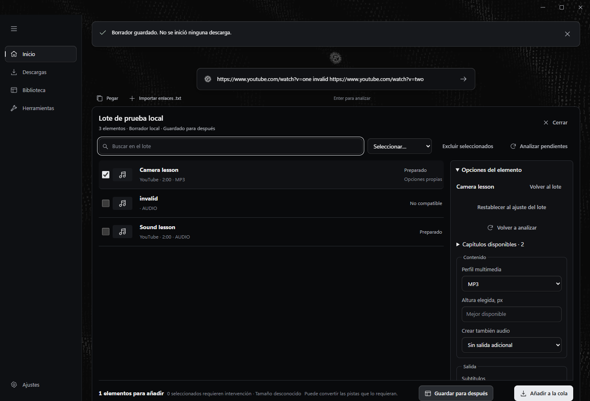
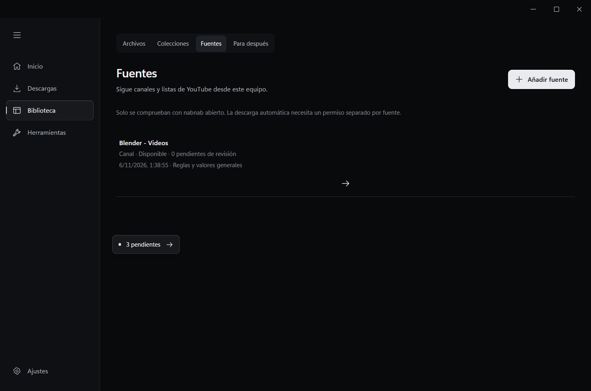
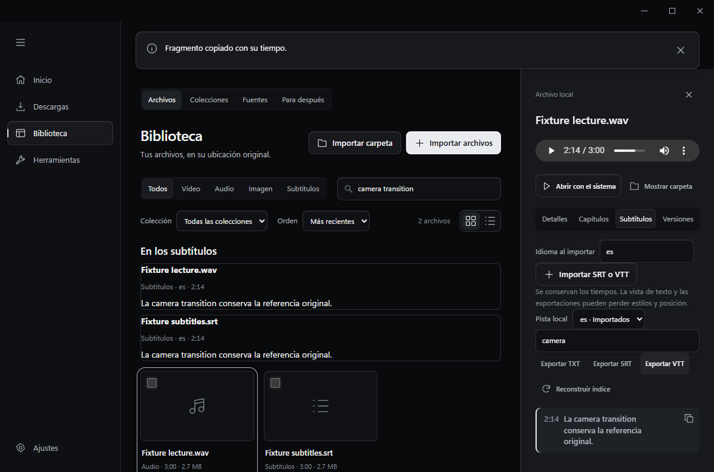
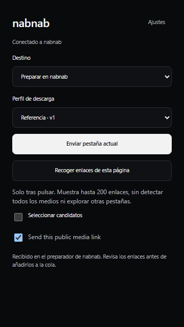
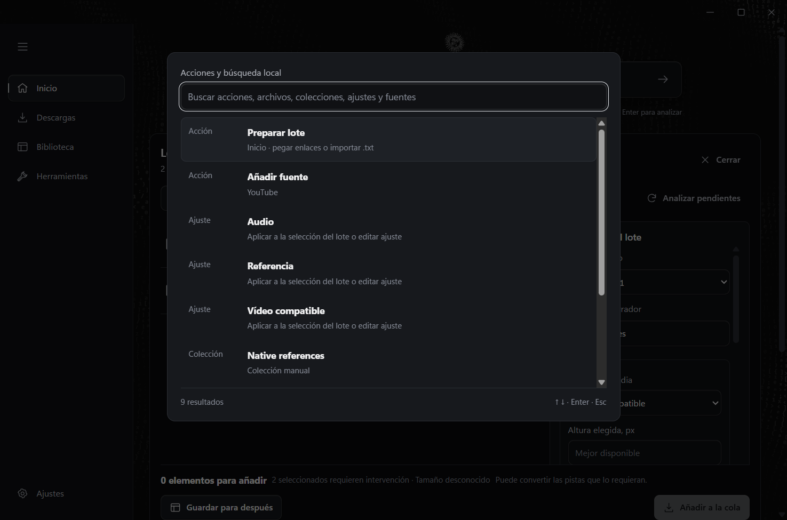

# Productividad local

Preparación de lotes, ajustes reutilizables, organización, seguimiento y búsqueda local sobre la misma cola y el mismo repositorio JSON de nabnab.

## Preparar, guardar y programar

1. Pega varios enlaces en Inicio y pulsa Enter, o importa un archivo `.txt`. Un enlace individual conserva su descarga rápida.
2. En el preparador, busca, selecciona resultados visibles o todo el lote y excluye lo que no quieras guardar. Una entrada inválida conserva las demás.
3. Elige un ajuste guardado. Abre un elemento para cambiar sus opciones y pulsa **Aplicar opciones**. Las excepciones se identifican como **Opciones propias** y pueden restablecerse.
4. Revisa **Archivos y operaciones previstos**, destinos y procedencia de las opciones. Los tamaños desconocidos se muestran como desconocidos.
5. Pulsa **Guardar para después** para conservar el borrador sin descargar, o **Añadir a la cola** para autorizar las salidas seleccionadas.

**Fragmentos y opciones**, en la previsualización de un enlace individual, abre el mismo preparador. Define inicio y fin, o selecciona capítulos reales disponibles. El corte preciso puede recodificar. Un fragmento puede requerir más transferencia que su duración o la descarga completa.

En Ajustes > Ajustes reutilizables puedes editar los ejemplos o crear uno. Cada trabajo conserva su versión resuelta. Para obtener vídeo y audio, selecciona **Crear también audio**. Cada salida aparece como una operación relacionada. Si una falla, se conservan las correctas y puedes reintentar la fallida.

El ejemplo Referencia solicita subtítulos en español y la colección Referencias. Cambia su idioma antes de usarlo si necesitas otra pista. Una pista ausente produce una incidencia de esa salida; no genera una transcripción.

La prioridad y el horario están en las opciones del preparador y en el inspector de trabajos pendientes de Descargas. **Ejecutar a continuación** respeta la disponibilidad y la programación del trabajo. Las franjas controlan el inicio; las operaciones activas pueden terminar. La política de un horario perdido permite ejecutar cuando sea posible o pausar para revisión.

## Organizar y seguir fuentes

En Ajustes > Organización, añade condiciones y acciones. La primera regla coincidente prepara las opciones. Puedes cambiar su posición y probarla con un elemento sin descargar ni mover archivos. Las variables admitidas son `{plataforma}`, `{creador}`, `{lista}`, `{fecha}`, `{titulo}` e `{id}`. La fecha se calcula en UTC. El inspector muestra de dónde procede cada valor y cada etiqueta.

En Biblioteca > Fuentes, pega un canal o una lista de YouTube. Elige por separado el alcance inicial y qué hacer con futuras incorporaciones. El valor inicial es **Desde ahora**, revisión manual, comprobación manual y descarga automática desactivada.

La primera página propone 50 posiciones. Una página parcial mantiene visible el contenido pendiente de explorar. El límite inicial de exploración es 200 y puedes ampliarlo. Las comprobaciones periódicas de 1, 6 o 24 horas necesitan activación explícita. La descarga automática también necesita permiso y un ajuste, con un máximo inicial de 20 incorporaciones por comprobación. El exceso y los casos ambiguos quedan para revisión.

El seguimiento y la programación requieren nabnab abierto, también en la bandeja cuando esté habilitada. No ejecutan tareas con la aplicación cerrada ni despiertan Windows. Quitar una fuente conserva los archivos; cancelar sus trabajos pendientes es una elección separada.

## Encontrar y reproducir

Biblioteca conserva cuatro vistas: Archivos, Colecciones, Fuentes y Para después. Solo Archivos representa resultados locales. Una colección inteligente guarda condiciones con **Todas** o **Alguna** y actualiza su contenido sin copiar archivos.

La búsqueda incluye títulos, autores, etiquetas, colecciones, marcadores y segmentos locales de subtítulos. Las coincidencias de subtítulos muestran texto y tiempo. Pulsa una coincidencia para buscar ese momento. En las variantes recortadas, el tiempo se convierte a la referencia correspondiente. Si el corte no tiene un inicio real verificable, se indica su carácter aproximado. Si no hay un reproductor controlable, se ofrece copiar el tiempo.

El inspector contiene Detalles, Capítulos, Subtítulos y Versiones. Puedes conservar la posición, añadir favoritos y marcadores, importar SRT o VTT, buscar dentro de una pista y exportar texto. Se distingue entre pistas del creador, automáticas e importadas. No se generan ni traducen subtítulos. Las exportaciones de texto y las conversiones pueden perder estilos; los tiempos se conservan.

## Usar la paleta y la extensión

Ctrl+K busca acciones, archivos, colecciones, ajustes y fuentes. Las flechas cambian la selección, Enter abre el contexto y Escape cierra. Aplicar un ajuste desde la paleta modifica la selección del lote; no inicia descargas.

La extensión ofrece Descargar, Preparar en nabnab y Guardar para después. Los ajustes se consultan en el escritorio. **Recoger enlaces de esta página** actúa solo al pulsarlo y permite seleccionar hasta 200 candidatos. No detecta todos los medios ni explora otras pestañas. El permiso `scripting` se utiliza con `activeTab`; no se añade acceso global a páginas ni cookies.

Si no llega una confirmación del escritorio, la extensión conserva la solicitud para reintentar. Preparar y Guardar reciben un identificador de borrador y no crean trabajos de descarga.

## Contratos e integración

`options.rs` resuelve ajustes versionados y reglas. `batch.rs` conserva borradores y prepara elementos. `sources.rs` enumera fuentes y entrega selecciones a la misma cola. `scheduling.rs` decide cuándo puede comenzar un trabajo. `library` y `captions` conservan metadatos, segmentos y búsqueda local. `queue.rs` es el único responsable de ejecutar y publicar salidas.

Cada salida relacionada es un trabajo de la cola con un grupo común. Permite conservar salidas correctas y reintentar errores individuales. `Job.options` conserva una copia de `ResolvedOptions`; la identidad de salida incluye contenido, formato, idioma y recorte. Las nuevas propiedades JSON usan valores predeterminados y mantienen los registros anteriores.

Los controladores de interfaz se conectan desde `main.ts` mediante callbacks. Los módulos específicos poseen sus propios tipos y vistas. La navegación principal se conserva. Biblioteca usa Archivos, Colecciones, Fuentes y Para después.

## Entregas y comprobaciones

- [x] A. Borradores, preparación progresiva, excepciones y ajustes.
- [x] B. Reglas, destinos seguros, prioridades, programación y salidas relacionadas.
- [x] C. Fuentes de YouTube, paginación e incorporaciones.
- [x] D. Subtítulos, capítulos, fragmentos, búsqueda, colecciones y marcadores.
- [x] E. Paleta, extensión e integración visual.

Comprobaciones realizadas el 6 de noviembre de 2026:

Pasaron 15 pruebas Node y 144 pruebas nativas. La suite ordinaria excluyó 17 pruebas optativas de motores, red o instalación. Se ejecutó aparte la prueba real de FFmpeg para subtítulos de recortes; las otras 16 no se ejecutaron en esta fase.

- TypeScript, identidad de producto, compilación Vite y ejecutable nativo.
- Suite Node, pruebas nativas deterministas y una prueba específica de FFmpeg real que recorta, ajusta subtítulos, los integra y vuelve a extraer sus tiempos.
- Recorridos de lotes, fuentes y biblioteca en Edge con IPC de prueba. Incluyen respuestas de análisis y guardado desordenadas, capítulos, variantes y salto real a 134,5 segundos en un WAV generado. Se probaron ventanas de 900 × 620 y tamaños de escritorio.
- App nativa con repositorio aislado: borradores, versiones, reglas sin operaciones, horarios, búsqueda de subtítulos en 3,25 segundos, marcadores, colecciones y recuperación tras reinicio.
- Extensión real emparejada: permiso `activeTab`, recogida explícita de enlaces, ajustes locales y entrega de Preparar y Guardar sin trabajos nuevos. También se comprobó descarga individual, reintento y revocación. El clic nativo del menú contextual no se repitió en esta fase.
- Consulta real de `https://www.youtube.com/@BlenderOfficial/videos`: 50 elementos, alcance parcial visible y cero trabajos añadidos. La renovación automática, sus límites, el historial ambiguo y las reordenaciones se verificaron con fixtures deterministas, no con descargas automáticas remotas.

Scripts reproducibles: `tests/batch.browser.mjs`, `tests/sources.browser.mjs`, `tests/library-productivity.browser.mjs`, `tests/native-productivity.browser.mjs` y `tests/native-extension.browser.mjs`. Usan `PLAYWRIGHT_MODULE` cuando Playwright está fuera del proyecto. Los dos scripts nativos requieren el ejecutable de depuración y el servidor Vite. Para repetir la consulta opcional de una fuente pública, define `NABNAB_SOURCE_TEST_URL` en el script nativo de productividad.

Los resultados detallados de esta ejecución están en `artifacts/`, excluido de Git. Las capturas anteriores se conservan en `docs/`. Las capturas de preparador y lector declaran sus fixtures; las de la aplicación nativa y la fuente usan IPC real.

No se ha generado un instalador o una release en esta fase. No se certifican otros proveedores para seguimiento ni todos los contenidos de YouTube. Una sesión requerida, una pista ausente o un límite del sitio conservan su estado de error o revisión. Los formatos del reproductor interno dependen de WebView2.

## Casos que requieren atención

Enlaces inválidos mezclados, cambios del ajuste después de encolar, rutas con enlaces simbólicos, historial parcial sin fechas, reinicios y cambios de horario, subtítulos de recortes y coincidencia entre encolado manual y automático.

## Documentación consultada

- [yt-dlp 2026.10.26](https://github.com/yt-dlp/yt-dlp/blob/2026.10.26/README.md), versión fijada en el repositorio.
- [FFmpeg](https://ffmpeg.org/ffmpeg.html), versión fijada 9.0.2.
- [serde_json](https://docs.rs/serde_json/), persistencia existente sin SQLite.

La búsqueda utiliza segmentos locales en el repositorio JSON. No se añade otra base de datos por disponer de FTS.
