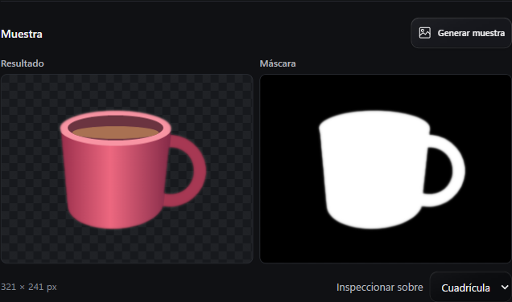

# Remove background

Install **U²-Net small · Windows ML** from **Settings → Engines → Optional components**. The same 4,574,861-byte ONNX file is downloaded and stored. The installer verifies its SHA-256 before activating it. Disabling the component keeps the model file. Removing the component deletes it.

Open **Tools → Image and composition → Remove background**. Choose a still PNG, JPEG or WebP from Library, then generate a preview. The left pane shows the cutout and the right pane shows its opacity mask. White keeps a pixel, black removes it, and gray shows partial opacity. The checkerboard, light and dark viewing surfaces help check halos around the subject.

Adjust the mask by up to eight pixels in either direction and select the amount of smoothing. Generate a new preview after changing an export setting. Choose a transparent background or a solid color, then export a PNG or lossless WebP. The queued result preserves the stored pixel dimensions and is linked to the original in Library. The source stays intact.

The model estimates the subject, so check fine details, shadows and similarly colored objects before exporting. It accepts still images up to 64 MiB, 8192 pixels per side and 24 million pixels total. The preview uses a smaller display copy when the long side exceeds 640 pixels.

Inference uses the system's `Windows.AI.MachineLearning` API on CPU. The worker runs in a separate process under nabnab's processing limit so cancellation can stop it. Windows x64 with Windows ML and nabnab's bundled FFmpeg are required. The model comes from rembg's `v0.0.0` release. Its SHA-256 starts with `309c8469`. U²-Net is published under Apache-2.0. [Model source](https://github.com/danielgatis/rembg/blob/main/rembg/sessions/u2netp.py) · [U²-Net license](https://github.com/xuebinqin/U-2-Net/blob/master/LICENSE) · [Windows ML CPU device](https://learn.microsoft.com/en-us/uwp/api/windows.ai.machinelearning.learningmodeldevicekind)
