# Investigación y audiolibros

En **Plataformas → Archivos y documentos**, pega un enlace, un identificador o un DOI. Selecciona los archivos, revisa el tamaño y el destino, y usa **Añadir a Descargas**. También puedes pegar enlaces de estos orígenes en Inicio. Las búsquedas de arXiv y LibriVox se pueden guardar en **Biblioteca → Fuentes** para revisarlas manualmente. Dentro de una ficha, **Volver a resultados** recupera las páginas ya cargadas y devuelve el foco a la fila que abriste.

## arXiv

- Busca por título, autor o categoría. Puedes abrir un identificador como `arXiv:2401.00001` o un enlace de artículo.
- Cada PDF tiene su propia fila con número de versión, nombre de archivo, fecha y licencia cuando arXiv las informa. **Ver ficha** abre el resumen, los autores y el identificador exacto de esa versión en la misma fila. Puedes consultar la ficha mientras preparas la descarga de otras versiones. **Cerrar ficha** devuelve el foco al botón que la abrió.
- El resumen encima de la lista corresponde a la versión más reciente. La referencia guardada identifica la versión exacta y conserva autores, fecha y licencia cuando los informa el origen.
- Si ya tienes esa versión en Biblioteca, la fila muestra el tamaño de la copia y **Abrir copia**. En **Fuentes** también puedes abrirla directamente. Las demás versiones mantienen su propio estado de revisión.
- La búsqueda consulta hasta 20 resultados por página y 200 por búsqueda. La API Atom se consulta de una en una, con tres segundos entre peticiones y una caché acotada en memoria.

[Manual de la API](https://info.arxiv.org/help/api/user-manual.html) · [Condiciones de la API](https://info.arxiv.org/help/api/tou.html) · [Disponibilidad por versión](https://info.arxiv.org/help/versions.html) · [Licencias de arXiv](https://info.arxiv.org/help/license/index.html)

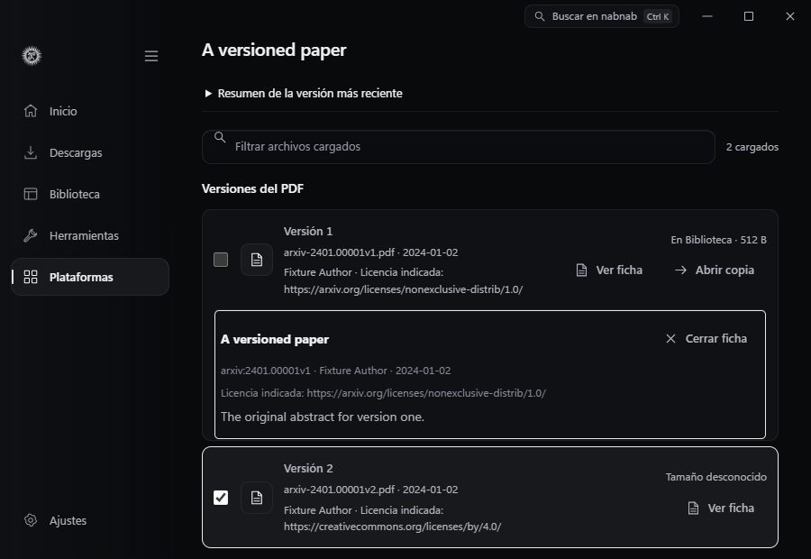

## Zenodo

- Abre un enlace de registro, un ID numérico o un DOI. La ficha distingue el registro concreto del conjunto al que pertenece. Cada archivo queda ligado al registro concreto, aunque se haya abierto mediante un DOI de conjunto.
- **Historial de versiones** enumera los registros públicos de la familia. Abre una versión para elegir sus archivos o usa **Seguir versiones** para revisar las novedades manualmente desde Biblioteca.
- Pega el enlace principal de una comunidad pública de Zenodo para ver sus registros recientes. **Cargar más** consulta bloques de 20, con un máximo de 200 por exploración. Abre un registro para revisar sus archivos y vuelve a la misma fila con **Volver a la comunidad**.
- **Seguir comunidad** guarda su identificador estable en **Biblioteca → Fuentes**. La revisión es manual. Abre el registro concreto antes de elegir archivos para Descargas.
- Revisa tipo, versión, tamaño y checksum de los archivos. La selección muestra el tamaño total conocido antes de enviar nada a la cola. Se verifica el checksum publicado MD5 o SHA-256 cuando esté disponible.
- **En Biblioteca** indica que ya tienes una copia de ese archivo del registro abierto. nabnab compara la versión y el checksum con la procedencia guardada, y el tamaño con el que figura en Biblioteca. **Mostrar carpeta** abre la ubicación de la copia en el Explorador. Los archivos de otro registro de la misma familia se revisan por separado.
- Pulsa **Verificar copia** para leer el archivo local y compararlo con el MD5 o SHA-256 publicado. El resultado aparece junto a la copia. Puedes cancelar la lectura de un archivo grande. [Campos de archivo de la API de Zenodo](https://developers.zenodo.org/#deposition-files)
- El filtro **Copia local** muestra todos los archivos, los que no tienen copia local o los que ya están en Biblioteca. **Marcar archivos sin copia** añade los archivos visibles que faltan a la selección. El lote admite hasta 199 archivos y la cola empieza al pulsar **Añadir a Descargas**.
- Usa **Solo seleccionados** para revisar todos los archivos marcados, incluidos los que el texto de búsqueda había ocultado. Puedes quitar archivos y ver cómo cambia el total. Pulsa el botón de nuevo para recuperar la búsqueda anterior.
- Los registros con archivos restringidos, embargados o sin acceso público declarado muestran metadatos sin permitir la descarga. La cola guarda archivos sin ejecutarlos.

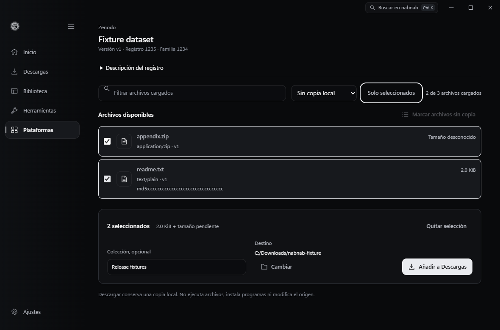

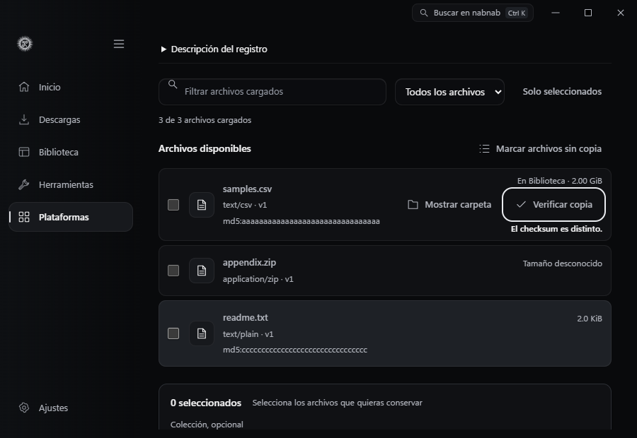

[API de registros y límites](https://developers.zenodo.org/#records) · [Versiones de registros](https://help.zenodo.org/docs/deposit/manage-versions/)

## LibriVox

- Elige un idioma y deja el título vacío para explorar las ediciones recientes en ese idioma. Usa **Cargar más** para pasar de una página a la siguiente. Cada página consulta hasta 25 posiciones y agrupa las fichas repetidas. **Seguir idioma** guarda el catálogo para revisarlo manualmente en Biblioteca → Fuentes.
- También puedes buscar por el comienzo del título y filtrar por idioma. Abre la edición correspondiente. Los capítulos muestran número, lector e idioma cuando están disponibles.
- Puedes combinar **Idioma del capítulo**, **Lectura** y la búsqueda de texto. La ficha muestra cuántos capítulos coinciden de los que ya se cargaron. Al entrar desde un catálogo por idioma, la ficha selecciona ese idioma si figura en los capítulos cargados.
- Marca capítulos individuales o selecciona los visibles. Cambiar de filtro conserva las marcas anteriores y el resumen muestra todo lo que se enviará a Descargas. Biblioteca identifica los archivos como audiolibro, conserva la edición y crea una colección para reunir sus capítulos. El filtro **Audiolibros** está en el selector de contenido de Biblioteca.
- La ficha indica cuántos capítulos de esa edición tienes disponibles en Biblioteca y los señala en la lista. **Abrir en Estantería** muestra la edición en **Biblioteca → Audio → Audiolibros**. La Estantería conserva el recuento total de archivos que publica el catálogo al descargar un capítulo. Desde allí puedes elegir un capítulo, continuar donde lo dejaste o volver a la ficha de esa edición. [Total de archivos en la API de LibriVox](https://librivox.org/api/info)
- En **Copia local**, elige **Sin copia local** para ver qué capítulos te faltan de esa edición. Combínalo con idioma, lector o búsqueda y pulsa **Marcar capítulos sin copia** para añadir los resultados visibles a la selección. Si falta un archivo en disco, su capítulo vuelve a aparecer con este filtro.
- Antes de añadir los capítulos a Descargas, pulsa **Solo seleccionados** para revisar todas las marcas, incluidas las que quedaron fuera del filtro. Desmarca los capítulos que quieras quitar. Pulsa el botón otra vez para volver a la búsqueda y los filtros anteriores.
- La búsqueda por título usa la API de audiolibros de 20 en 20. La exploración por idioma usa la lista y la paginación de la [búsqueda pública de LibriVox](https://librivox.org/search). Al abrir una edición, la aplicación lee el RSS y, para los archivos alojados en Internet Archive, reutiliza las comprobaciones de acceso y las descargas de ese adaptador. La ficha conserva la declaración de dominio público de LibriVox para Estados Unidos. Comprueba la situación en tu país.

[Catálogo oficial](https://librivox.org/api/info) · [Dominio público](https://librivox.org/pages/public-domain/)

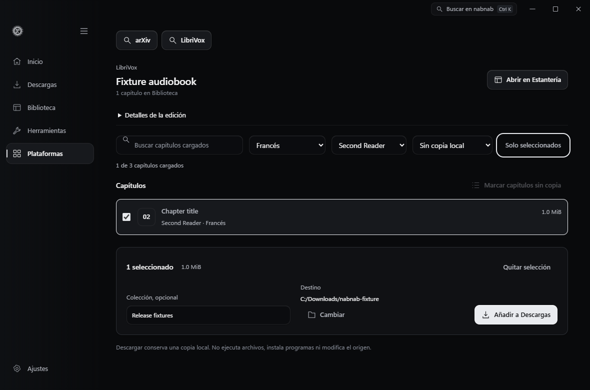

## Cursos

El flujo de Rocketseat, Coursera, Domestika y Skillshare utiliza el sitio oficial para la sesión del alumno y la descarga permitida por ese sitio. En nabnab puedes importar la carpeta elegida y estudiar sus materiales con el orden y el progreso de Cursos. La [guía de cursos](COURSES.md) detalla qué materiales admite cada plataforma y el alcance de esta integración.

## Comprobaciones

La prueba de interfaz usa datos simulados. Recorre la selección por versión, el retorno con teclado tras paginar o encontrar un error, y la selección de capítulos en ventanas de 1180 × 780 y 900 × 620. Las pruebas Rust cubren identidad por versión, lectura de metadatos, capítulos ordenados y seguimiento manual.

Con `NABNAB_RESEARCH_ARXIV_DETAILS_ONLY=1`, la prueba de Windows abre la ficha pública de `2506.08399v1` mientras está marcada la v2. Comprueba que conserva la selección y el foco al cerrar y que la consulta de la ficha por sí sola no prepara una descarga. La prueba de Edge usa dos licencias y resúmenes distintos para verificar a qué versión corresponde cada dato. [Artículo de arXiv](https://arxiv.org/abs/2506.08399v1)

La prueba nativa descargó dos versiones distintas del mismo PDF de arXiv y comprobó que ambas se conservan. Descargó un CSV de Zenodo de 450 bytes y verificó el MD5 publicado. Descargó dos capítulos de LibriVox en orden inverso y comprobó el orden de lectura en Biblioteca. [Artículo de arXiv](https://arxiv.org/abs/2506.08399) · [Registro de Zenodo](https://zenodo.org/records/14634897) · [Edición de LibriVox](https://librivox.org/aesops-fables-volume-1-fables-1-25/)

Con `NABNAB_RESEARCH_ZENODO_ONLY=1`, la prueba nativa descarga solo ese CSV. Al abrir el DOI del conjunto desde Inicio, comprueba que la ficha identifica la copia descargada y que no se crea otro trabajo. La prueba de Edge verifica la acción **Mostrar carpeta** con teclado a 900 y 1180 px y distingue una copia ausente, una versión distinta y discrepancias de tamaño o checksum.

La prueba por idioma consultó dos páginas reales en español. La primera mostró 23 ediciones distintas y la segunda avanzó aunque sus capítulos pertenecían a una edición ya visible. Se abrieron los capítulos de *La desheredada*, se volvió a la misma fila y se guardó la revisión manual con 23 ediciones y cero trabajos de descarga. [La desheredada en LibriVox](https://librivox.org/la-desheredada-by-benito-perez-galdos/)

Para repetir la prueba nativa, inicia Vite en el puerto 1420 y ejecuta `node tests/native-research.browser.mjs` con Playwright y el ejecutable de depuración de Windows disponibles. Los archivos y el perfil de prueba quedan en `artifacts/native-research`.

Con `NABNAB_RESEARCH_LANGUAGE_ONLY=1` la prueba se limita a consultar el catálogo de LibriVox, abrir una edición y guardar un seguimiento manual con un límite de 25 posiciones.

Con `NABNAB_RESEARCH_COMMUNITY_ONLY=1`, la prueba nativa consultó 14 registros públicos de una comunidad de Zenodo. Abrió un registro concreto, volvió a la misma fila y guardó el seguimiento manual. Guardar de nuevo con el identificador estable reutilizó la misma fuente y Descargas quedó vacía. La prueba de Edge comprobó la paginación y el regreso con datos simulados a 900 y 1180 px. [Comunidad de prueba](https://zenodo.org/communities/cfa)

Con `NABNAB_RESEARCH_CHAPTER_FILTERS_ONLY=1` la prueba combina idioma y lectura en una edición multilingüe, cambia el filtro y recupera el capítulo marcado con **Solo seleccionados**. La cola descargó únicamente el capítulo 3, leído en español por Alexandria Adair, con 1.048.675 bytes. **Abrir en Estantería** enfocó esa edición y mostró un capítulo disponible frente al total de la API, con el reproductor vacío. Edge comprobó a 900 y 1180 px la búsqueda por lector e idioma, el recuento con una copia duplicada y el estado de los archivos ausentes con datos de prueba. [Edición multilingüe en LibriVox](https://librivox.org/mini-multilingual-bedtime-stories-2-by-aesop/)

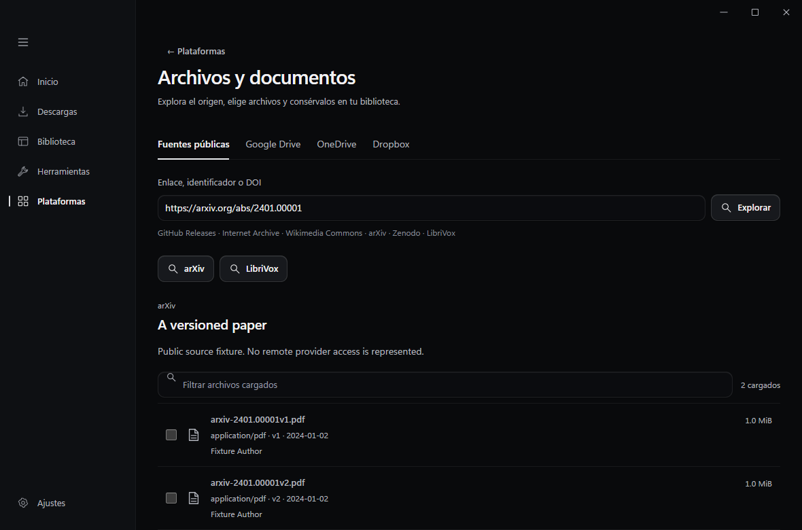

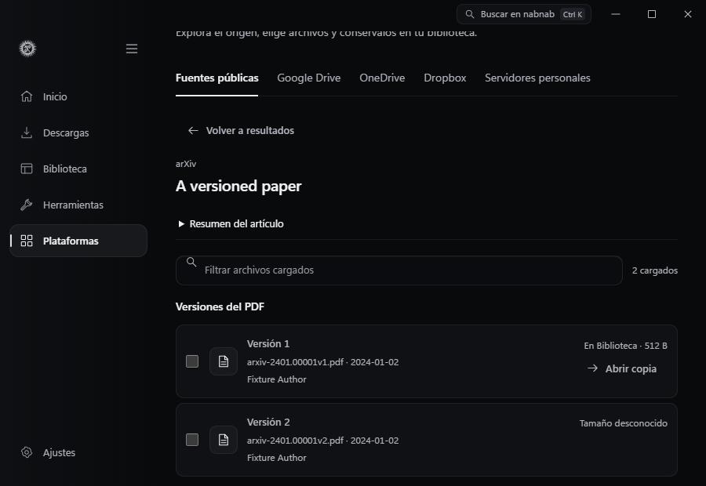

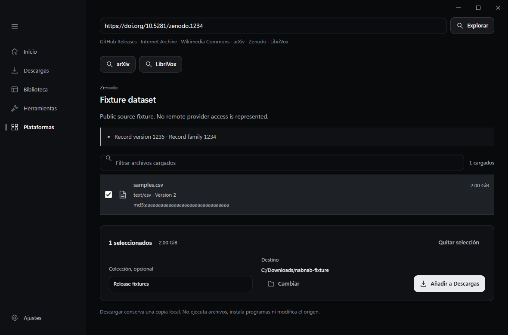

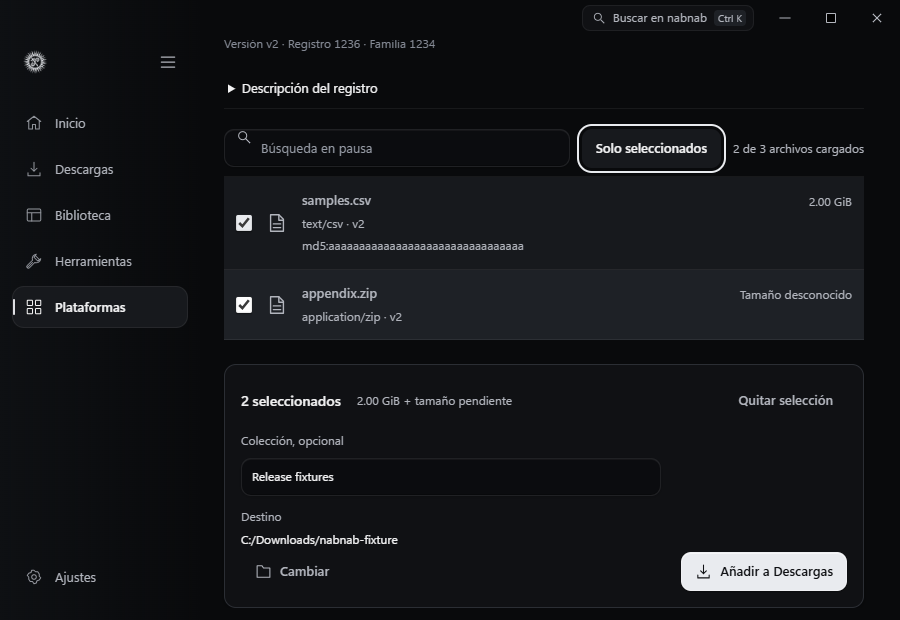

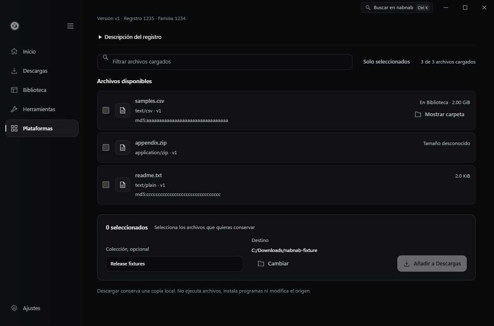

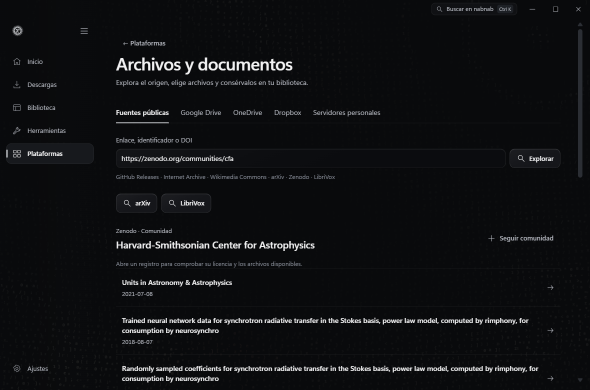

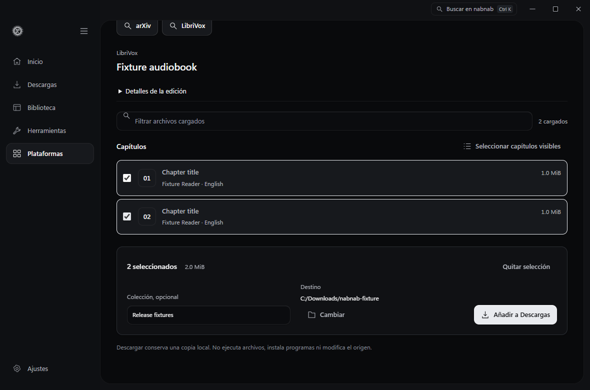

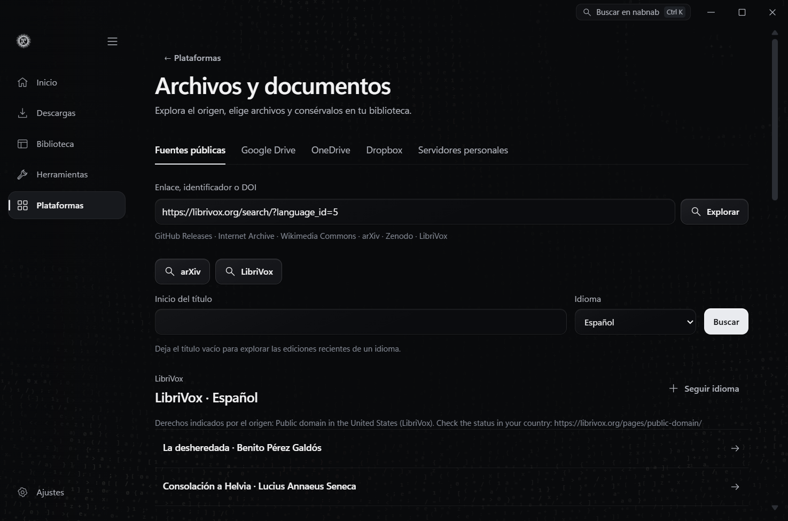

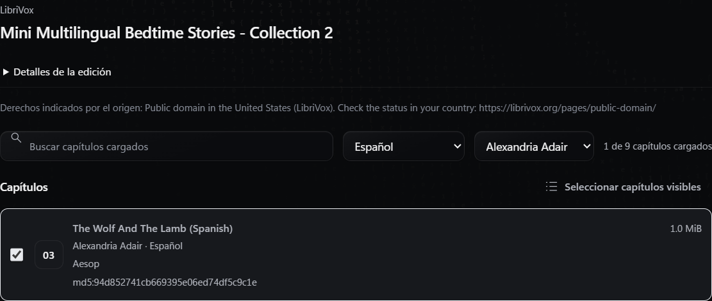

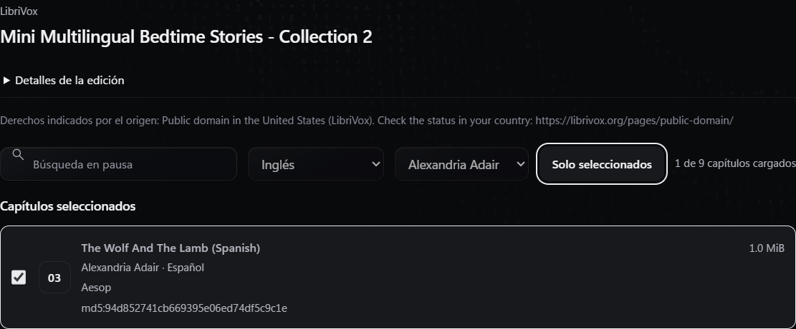

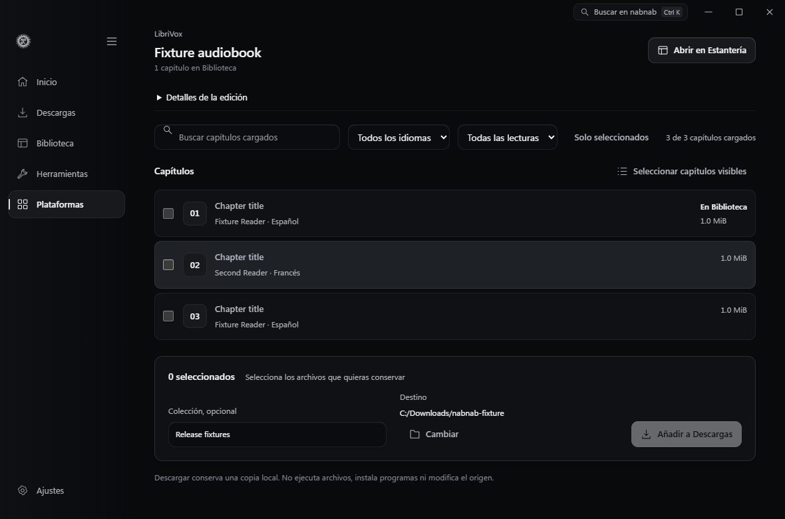
