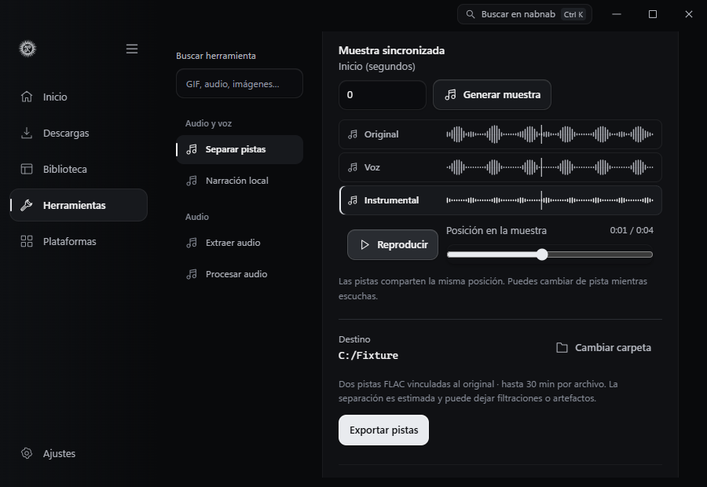

# Separar pistas

En **Herramientas → Audio y voz → Separar pistas**, elige un audio o vídeo de Biblioteca, indica el segundo de inicio y genera una muestra de hasta ocho segundos. Puedes reproducirla, buscar una posición y cambiar entre Original, Voz e Instrumental sobre el mismo reloj de reproducción.

Las tres formas de onda usan la misma escala y comparten un cursor. Puedes ver dónde aparece señal en cada pista y pulsar su fila para escucharla desde el mismo punto. La barra inferior permite buscar con el ratón o las flechas del teclado.

La separación es una estimación. Puede dejar restos de voz en el instrumental o introducir artefactos. El modelo disponible entrega dos pistas. La exportación genera dos FLAC de 44,1 kHz en una subcarpeta del destino y conserva el original. En Biblioteca ambas pistas se vinculan al original y comparten un conjunto y una colección. Las entradas mono conservan un canal, las estéreo conservan dos y las multicanal se mezclan a estéreo.

## Pistas completas

Selecciona el archivo original en **Separar pistas** para ver su última exportación. Alterna entre Original, Voz e Instrumental sin perder la posición ni el estado de pausa. Usa la barra inferior para pausar o buscar en la pista completa. Las pistas exportadas siguen disponibles aunque desinstales el modelo.

**Enviar las dos pistas** abre la revisión de KDE Connect con los dos FLAC. Si solo queda uno en Biblioteca, puedes enviar la pista disponible. Revisa la selección y elige el dispositivo antes de confirmar.

## Instalación

**Ajustes → Componentes** muestra la procedencia, las licencias y los tamaños antes de instalar. El componente requiere Windows x64, CPU y el runtime de Microsoft Visual C++. Descarga 39,2 MiB y ocupa 53,8 MiB instalado. Los dos paquetes y los cinco archivos instalados tienen tamaños y SHA-256 fijados en el código. Nabnab elimina los paquetes tras extraer los archivos necesarios y permite desinstalar el componente desde Ajustes.

El paquete usa Spleeter de Deezer en FP16, convertido para sherpa-onnx 2.0.1. La inferencia se ejecuta en un proceso de nabnab con un hilo configurado para el modelo. Utiliza el FFmpeg de la aplicación para decodificar, conservar la alineación a nivel de muestra, limitar picos y comprimir los FLAC. Funciona sin conexión después de instalarlo. [Conversión y modelo](https://k2-fsa.github.io/sherpa/onnx/source-separation/models.html) · [Paquete del motor](https://github.com/k2-fsa/sherpa-onnx/releases/tag/v2.0.1) · [Artículo de Spleeter y licencia del modelo](https://github.com/deezer/spleeter/blob/master/paper.md)

La cola comparte el límite de procesamiento con ampliación y transcripción. Cancelar la muestra o la tarea detiene su proceso. Los fragmentos de inferencia solapados acotan la memoria y los archivos intermedios se eliminan al terminar. El límite de 30 minutos por archivo acota el espacio temporal.

## Verificación

El recorrido nativo de Windows verificó la instalación desde Ajustes, el cambio de pista durante la reproducción y la vista a 1180 y 900 px. Una mezcla mono sintética de 927 423 muestras conservó el canal y la duración en los dos FLAC. Sus picos quedaron por debajo del máximo PCM y el hash del original se mantuvo. Una muestra estéreo conservó dos canales. Cancelar una segunda tarea en curso eliminó sus archivos temporales.

[Muestra en Herramientas](stems-preview.png)

La prueba de resultados en WebView2 reproduce un MP4 y dos FLAC sintéticos de 21 segundos, cambia de pista en reproducción y en pausa, y verifica los dos archivos que recibe el simulador de KDE Connect después de confirmar.

[Pistas completas en Herramientas](stems-results.png)
