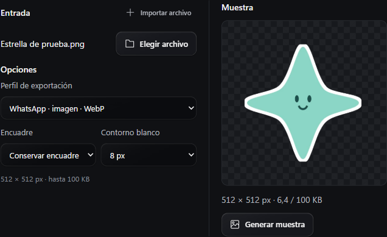

# Stickers

Open **Tools → Image and composition → Stickers**. Choose an image, GIF or video from Library, or use the existing Import file action. Keep the framing or choose a square crop and move its horizontal or vertical position. The optional white outline follows the source alpha and the crop edges. Transparent padding gives every export a 512 × 512 canvas.

| Profile | Output | File limit | Duration |
| --- | --- | --- | --- |
| Telegram image | Transparent WebP | 512 KB | Single frame |
| Telegram video | Transparent VP9 WebM, silent | 256 KB | Up to 3 seconds |
| WhatsApp image | Transparent WebP | 100 KB | Single frame |
| WhatsApp animation | Transparent animated WebP | 500 KB | Up to 10 seconds |

For a still from a GIF or video, enter the frame time. For animation, set the start and length. **Generate preview** encodes the result and reports its actual size and duration. The encoder tries progressively smaller settings if needed. A shorter or simpler excerpt can fit when the chosen source exceeds the profile's byte limit.

Choose the destination and select **Queue export**. Changes to the source or options require a fresh preview. The job uses the normal processing limit and publishes a new file linked to the original in Library.

- In Telegram, open **@Stickers**, choose a compatible pack, and attach the WebP or WebM file. [Telegram import formats](https://core.telegram.org/import-stickers)
- For WhatsApp, import the WebP into a compatible pack app, then add the pack from the phone. A pack contains 3–30 stickers and uses a single sticker type. [WhatsApp pack requirements](https://github.com/WhatsApp/stickers/blob/main/Android/README.md#sticker-art-and-app-requirements)

The tool runs offline with the included FFmpeg and FFprobe. It accepts PNG, JPEG, WebP, BMP, GIF, MP4, M4V, MOV, MKV and WebM, with input limits of 512 MiB and 24 million pixels per frame. Animated input uses GIF or video. Transparent source regions are preserved. Subject segmentation is a separate tool.
