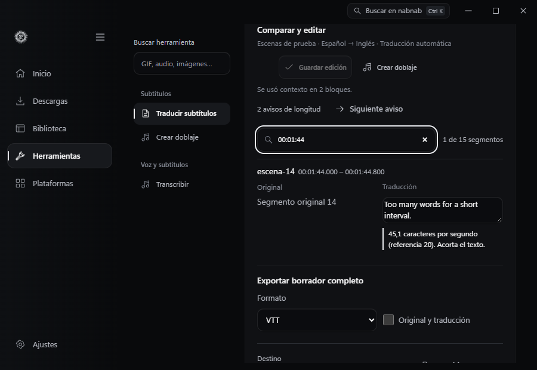
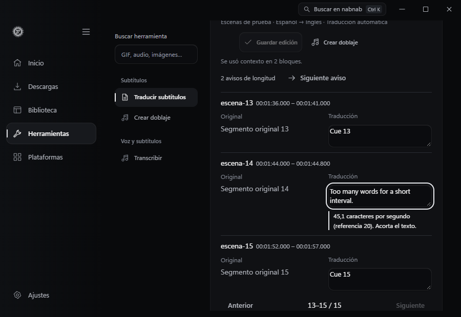
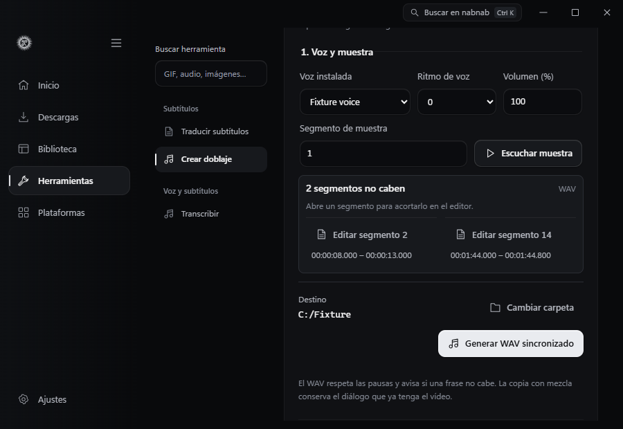
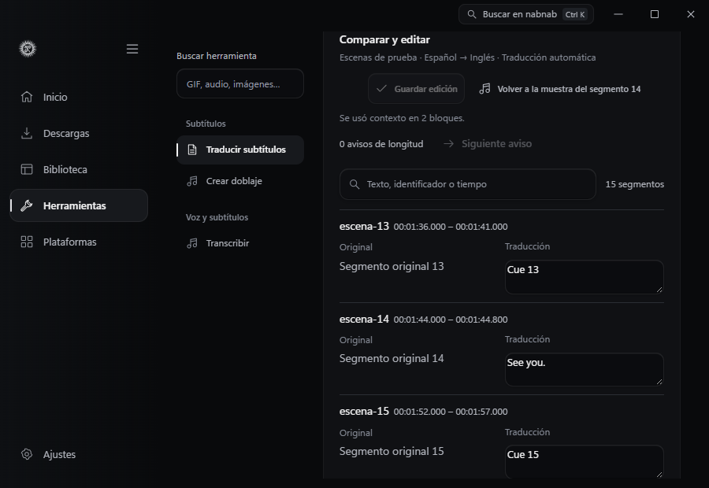
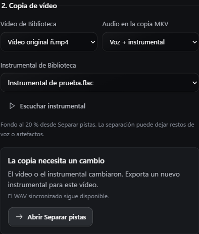
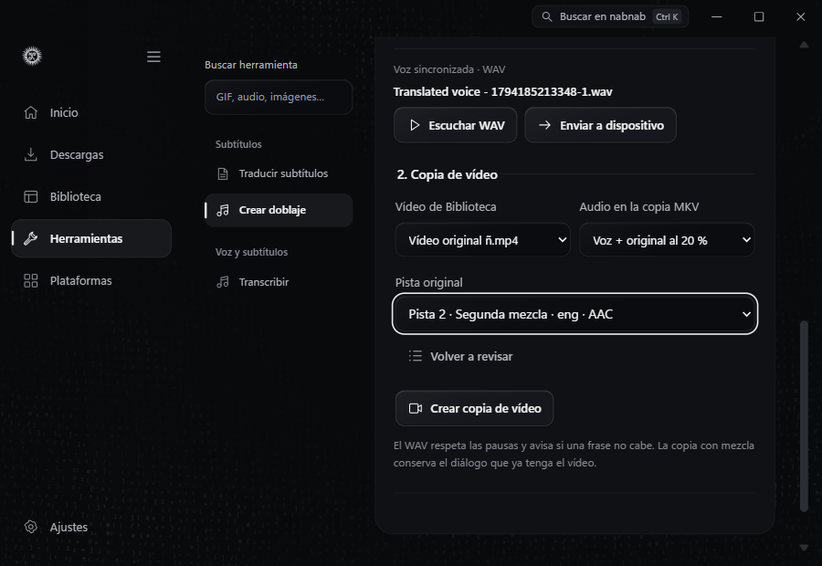
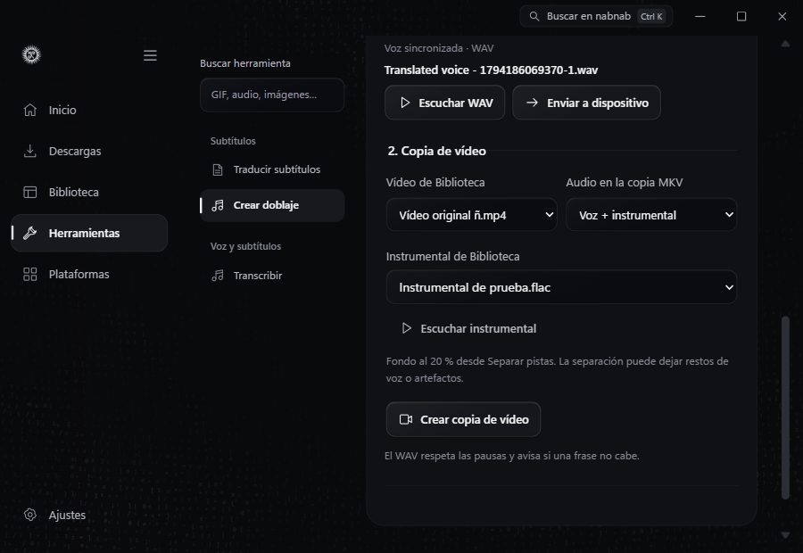

# Traducir subtítulos

Abre **Herramientas → Subtítulos → Traducir subtítulos** o elige **Traducir pista** en el inspector de Biblioteca. Puedes usar una pista ya asociada a un archivo o importar un SRT o VTT. En **Ajustes → Componentes**, instala la dirección que necesites. Español → Inglés e Inglés → Español se ejecutan directamente.

1. Selecciona la pista y revisa los primeros segmentos antes de traducir.
2. Abre el borrador cuando termine la tarea. El original y la traducción se muestran en columnas, con el identificador y el intervalo de cada segmento. Edita el texto y guarda los cambios. La revisión sigue marcada como traducción automática.
3. Exporta SRT o VTT. Activa **Original y traducción** para incluir las dos versiones en cada segmento. VTT conserva los identificadores de texto. SRT usa identificadores numéricos. Cada exportación es un archivo nuevo vinculado a su entrada en Biblioteca.

Cuando la exportación está lista, **Última exportación** muestra el archivo de la revisión, formato y variante elegidos. Pulsa **Enviar a dispositivo** en esa fila para revisar su nombre y tamaño antes de confirmar con KDE Connect. [Envío a un dispositivo](DEVICE-SHARE.md)

El motor agrupa segmentos cercanos cuando puede recuperar cada traducción en orden. Si un bloque pierde la correspondencia, traduce sus segmentos por separado. Se conservan los tiempos y las etiquetas simples de negrita, cursiva y subrayado cuando las mantiene el motor. La herramienta avisa si un segmento supera 42 caracteres por línea o 20 por segundo. VTT conserva tiempos a milisegundos. Los estilos de posición, regiones y CSS quedan en el archivo original.

**Siguiente aviso** abre la página del próximo segmento y enfoca su traducción. Cada aviso distingue una línea larga de una lectura demasiado rápida y se actualiza al editar. Las correcciones que hagas en páginas distintas se guardan juntas al pulsar **Guardar edición**.

**Buscar segmentos** encuentra texto del original o de la traducción, identificadores y horas de inicio o fin. Puedes escribir una parte del tiempo, como `01:44`. Las marcas de tiempo y el orden se conservan al filtrar. Las ediciones pendientes siguen disponibles al cambiar de búsqueda. Si saltas a un aviso de longitud o doblaje, el editor limpia la búsqueda y enfoca el segmento. **Exportar borrador completo** incluye todos los segmentos.

## Componentes

Bergamot 0.4.9 requiere Windows x64 y usa el Deno de nabnab. Tanto el motor como los pesos se distribuyen bajo MPL-2.0. La primera instalación descarga aproximadamente entre 15,8 y 16,6 MiB, según la dirección. El runtime y el vocabulario compartidos ocupan 5,8 MiB. Una segunda dirección descarga únicamente sus propios pesos y tabla léxica. Los archivos descomprimidos y el paquete del motor se verifican con SHA-256. [Motor y procedencia](https://github.com/browsermt/bergamot-translator/tree/main/wasm/module) · [Modelos de Firefox](https://github.com/mozilla/firefox-translations-models)

La inferencia ejecuta Deno con acceso a las carpetas de entrada y de modelo estrictamente necesarias y con red, escritura, ejecución externa y FFI denegados. Los temporales y la caché de ese proceso se retiran al terminar. Desactivar una dirección conserva sus archivos. Eliminarla libera su espacio y elimina el runtime compartido si era la última. Los borradores y las exportaciones se conservan. Puedes retirar un borrador desde Herramientas para liberar su espacio.

## Doblaje local

Abre **Herramientas → Subtítulos → Crear doblaje** o búscalo con **Ctrl + K**. Elige una traducción guardada. Si vienes del editor, pulsa **Crear doblaje** para abrir la herramienta con ese borrador seleccionado. **Editar traducción** te devuelve al mismo borrador. El doblaje de un borrador guardado solo requiere **Voz local** y las voces de escritorio instaladas en Windows para su idioma de destino. Puedes elegir un segmento y escuchar una muestra antes de generar el audio.

**Generar WAV sincronizado** añade un trabajo a Descargas. La voz ocupa el intervalo de cada subtítulo y las pausas quedan en silencio. Cuando dos intervalos se superponen, la primera frase dispone de tiempo hasta el comienzo de la siguiente. Si hace falta, la voz se acelera hasta un 25 %. El flujo admite hasta 4096 segmentos en las primeras dos horas de la pista. [Filtro `atempo` de FFmpeg](https://ffmpeg.org/ffmpeg-filters.html#atempo)

Si quedan frases que no caben, el panel muestra hasta 16 avisos por intento. Cada aviso indica el intervalo original y tiene su propio botón **Editar segmento**. En el editor, **Siguiente aviso de doblaje** sigue visible al recorrer la comparación y enfoca la siguiente frase marcada, aunque esté en otra página. Los avisos describen la última síntesis y quedan atrás al guardar una nueva revisión. Guarda la edición y pulsa **Volver a la muestra del segmento**. nabnab selecciona el último segmento que abriste desde un aviso y enfoca **Escuchar muestra** para probar la revisión guardada.

Cada segmento se reutiliza según su texto, voz, volumen y ritmo. Al editar el borrador, la nueva versión puede aprovechar el audio de los segmentos que conservan esos datos. La caché de voz comparte el espacio administrado con Narración local. El WAV y las copias de vídeo se guardan en el destino seleccionado.

Con el WAV disponible, puedes escucharlo o crear una copia MKV del vídeo. **Pista alternativa** conserva las pistas originales y añade la voz. **Solo voz traducida** crea una copia con el WAV como audio. En **Voz + original al 20 %**, pulsa **Revisar pistas** y elige cuál usar. El selector muestra título, idioma y códec cuando el archivo los declara. La mezcla combina la voz al 80 % con la pista elegida al 20 %. Si esa pista contiene diálogo, seguirá presente en la mezcla. Los subtítulos de texto `mov_text` se convierten a SubRip para la copia MKV. El vídeo se copia sin recodificar. [Selección de pistas en FFmpeg](https://ffmpeg.org/ffmpeg.html#Stream-specifiers)

La copia de vídeo tiene su propio trabajo en Descargas. **Reintentar copia** vuelve a ejecutar ese trabajo con el WAV ya publicado. Si los archivos elegidos son incompatibles, **La copia necesita un cambio** explica el motivo y da acceso a la corrección. Puedes revisar las pistas, usar solo la voz traducida en un vídeo sin audio, elegir el vídeo que corresponde al WAV o volver a Separar pistas para exportar el instrumental. Si restauraste una pista original, revísala antes de reintentar el mismo trabajo. El WAV y el MKV tienen acciones separadas para reproducir y enviar cada archivo. [Panel de doblaje en Windows](dubbing-native.png)

Para usar una separación ya exportada, elige **Voz + instrumental**. Selecciona el FLAC de **Separar pistas** asociado al mismo vídeo. Puedes escucharlo antes de crear la copia. La mezcla conserva el retraso inicial indicado por la pista de origen y usa el instrumental al 20 %. La separación es estimada y puede dejar restos de voz o artefactos. [Separar pistas](STEMS.md) · [Mezcla de audio con FFmpeg](https://ffmpeg.org/ffmpeg-filters.html#amix)

Si el vídeo cambió desde la separación, exporta un instrumental de la versión actual. nabnab verifica el origen antes de publicar el MKV y conserva el WAV y el instrumental para que puedas revisar el trabajo.

## Verificación

El recorrido nativo de Windows instaló las dos direcciones desde Ajustes, con un único runtime y vocabulario. Tradujo un VTT local, conservó cuatro identificadores y sus tiempos, y mantuvo la cursiva. Se guardó una corrección, se reabrió el borrador y se verificaron el VTT bilingüe y el SRT traducido. El original quedó idéntico y los directorios temporales quedaron vacíos. La comparación se comprobó a 1180 y 900 px. [Comparación y aviso de longitud](translation-preview.png)

`tests/native-dubbing.browser.mjs` parte de un borrador sintético y utiliza SAPI y FFmpeg reales. Abre la herramienta desde el catálogo y Ctrl + K, comprueba el foco del selector y conserva las ediciones sin guardar al cambiar de herramienta. También verifica la decodificación de la muestra, el acceso directo a dos avisos de síntesis, la reutilización de una frase al editar las otras dos y los silencios del WAV. Verifica las tres copias MKV con FFprobe, la diferencia entre mezclar y sustituir el audio, el reintento de un trabajo fallido y la integridad del WAV y del vídeo original. El panel se revisó a 1180 y 900 px. Un ejecutable de prueba de KDE Connect registra la ruta de cada VTT, WAV y MKV después de la confirmación explícita desde el panel.

El vídeo de prueba lleva tonos distintos en cada pista. El MKV mezclado contiene el tono de la segunda pista durante una pausa del doblaje. La prueba también solicita una pista que ya no coincide con el vídeo y comprueba que se conserva el WAV publicado.

La prueba usa un FLAC instrumental sintético con un tono de 540 Hz. Comprueba el silencio inicial, la aparición del tono en el MKV y el rechazo de la mezcla si cambia el vídeo. Verifica que el WAV y el FLAC se conservan. El selector se revisó a 900 y 1180 px.

La prueba del editor en Edge verifica búsqueda, paginación, avisos y foco a 900 y 1180 px. La prueba nativa de doblaje guarda dos correcciones y vuelve a la muestra de la última frase revisada. Comprueba que el foco llega al botón cuando la voz está lista y que la muestra reproduce el texto de la nueva revisión. La prueba de traducción en Windows verifica el VTT completo con el filtro activo.
